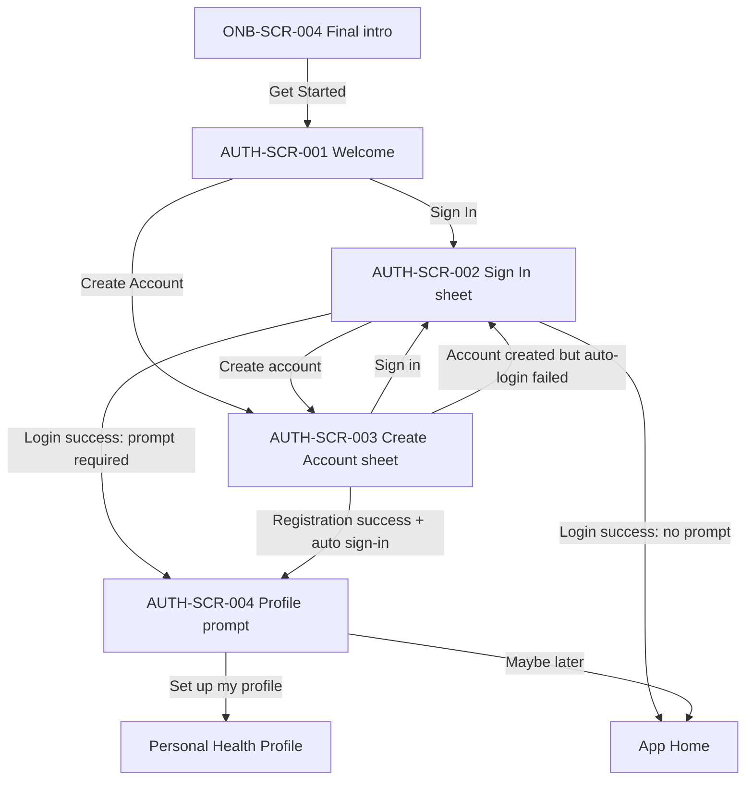

# Authentication — Screen Behavior

> **Status:** APPROVED VISUAL; USER-APPROVED hub → bottom-sheet interaction; domain requirements cited from F1 and F2. Additional UX recommendations labeled PROPOSED or OPEN.  
> **Scope:** Authentication entry, login, registration, optional health-profile setup handoff.  
> **Standard:** [BEHAVIOR_STANDARD.md](../BEHAVIOR_STANDARD.md)  
> **Domain:** [F1 Account Access](https://github.com/vitaloom/vitaloom-business-docs-and-tools/tree/main/docs/usecase_spec/authentication/f1-account-access) · [F2 Session Control](https://github.com/vitaloom/vitaloom-business-docs-and-tools/tree/main/docs/usecase_spec/authentication/f2-session-control) · [Personal Health Profile](https://github.com/vitaloom/vitaloom-business-docs-and-tools/tree/main/docs/usecase_spec/personal-health-profile)

## 1. Screen registry

| Screen ID | Design | When shown | Exit / navigation |
| --- | --- | --- | --- |
| `AUTH-SCR-001` | [Authentication welcome](01-auth-welcome.webp) | After [`ONB-SCR-004`](../onboarding/04-see-your-progress.webp) when manual auth is required | Choose login or sign-up sheet |
| `AUTH-SCR-002` | [Sign In sheet](02-sign-in.webp) | User chooses Sign In | Valid login → app/optional profile prompt; switch to sign-up; close → welcome |
| `AUTH-SCR-003` | [Create Account sheet](03-create-account.webp) | User chooses Create Account | Valid registration and automatic login → profile prompt; switch to sign-in |
| `AUTH-SCR-004` | [Profile setup invitation](04-setup-profile-prompt.webp) | Authenticated account needs first-time health-profile onboarding proposal | “Set up my profile” → Personal Health Profile; “Maybe later” → Home |

## 2. Navigation flow

**Important:** Registration is not followed by a second login form when automatic sign-in succeeds. Profile setup is optional. A returning user who previously skipped health-profile onboarding must not be forced through it again (BR-F1.14).

## 3. Authentication entry and sheet behavior

| Action ID | Element / trigger | Immediate UI response | Destination / result | Status |
| --- | --- | --- | --- | --- |
| `AUTH-ACT-001` | `AUTH-SCR-001` / Sign In | Raise rounded white form sheet over retained welcome hero | `AUTH-SCR-002` | USER-APPROVED |
| `AUTH-ACT-002` | `AUTH-SCR-001` / Create Account | Raise corresponding form sheet over retained hero | `AUTH-SCR-003` | USER-APPROVED |
| `AUTH-ACT-003` | Sheet / system Back or close | Dismiss sheet; keep branded welcome screen | `AUTH-SCR-001` | PROPOSED |
| `AUTH-ACT-004` | Sign In / Create account link | Switch form content without losing shared design | `AUTH-SCR-003` | DESIGN INTENT |
| `AUTH-ACT-005` | Create Account / Sign in link | Switch form content without losing shared design | `AUTH-SCR-002` | DESIGN INTENT |
| `AUTH-ACT-006` | Password eye icon | Toggle masking without editing value | Stay in current sheet | CONFIRMED (BR-F1.6) |

**Sheet presentation:** bottom-anchored white surface with rounded upper corners; a single sheet active at a time, keeping the underlying hero visible. Optional slide-up/down transition should respect reduced motion. Keyboard avoidance, focus management and safe-area behavior required. Swipe-to-dismiss and tapping outside the sheet are OPEN decisions; neither should silently discard input.

## 4. Registration behavior — AUTH-UC-001

**Design:** [03-create-account.webp](03-create-account.webp).

| Action ID | Trigger or condition | Expected UI behavior | Result | Reference |
| --- | --- | --- | --- | --- |
| `AUTH-ACT-010` | Enter email | Allow usual email input, trim leading/trailing spaces for identity comparison | Ready for validation | BR-F1.1, BR-F1.2 |
| `AUTH-ACT-011` | Enter password | Mask by default, preserve exact password including any spaces; eye reveals only on explicit tap | Password entered | BR-F1.5, BR-F1.6 |
| `AUTH-ACT-012` | Submit empty/invalid email | Show inline field error, do not create account | Stay in form with values retained | BR-F1.8 |
| `AUTH-ACT-013` | Submit password shorter than 8 characters | Show password hint/error, block registration | Stay in form; don't clear password unless required by security policy | BR-F1.5, BR-F1.8 |
| `AUTH-ACT-014` | Email already registered | Explain conflict, suggest Sign In or another email | No duplicate account | BR-F1.3 |
| `AUTH-ACT-015` | Submit valid registration | Show pending/disable duplicate submits; create account, automatically establish session | `AUTH-SCR-004` when prompt applicable | BR-F1.4, BR-F1.7, BR-F1.14 |
| `AUTH-ACT-016` | Account created, automatic sign-in failed | Explicitly state account **already exists**, offer manual Sign In | `AUTH-SCR-002`; do not re-register | BR-F1.7 |

**Rules:** Email identity is case-insensitive, ignores only leading/trailing whitespace, and does **not** remove dots or `+tag`. Password is **at least 8 characters**, not auto-trimmed, no mandated uppercase/number/special combination, and no confirm password field. No email verification after registration.

## 5. Login behavior — AUTH-UC-002

**Design:** [02-sign-in.webp](02-sign-in.webp).

| Action ID | Trigger / state | Visible response | Result | Reference |
| --- | --- | --- | --- | --- |
| `AUTH-ACT-020` | Tap Sign In with valid credentials | Pending indicator, prevent duplicate submissions | Establish valid session; route by profile/onboarding status | BR-F1.9, BR-F1.12, BR-F1.14 |
| `AUTH-ACT-021` | Wrong credentials | Generic auth error that does **not** reveal if email exists | Stay in form, allow correction | BR-F1.9, BR-F1.16 |
| `AUTH-ACT-022` | Admin-locked/disabled account | Show explicit blocking notice and require acknowledgment | Remain/return to login, no new session | BR-F1.13; F2 |
| `AUTH-ACT-023` | Reopen app with valid refresh authentication | Restore session automatically without asking for credentials | App Home/eligible profile prompt | F2 session rules |
| `AUTH-ACT-024` | Access token expired but refresh still valid | Refresh transparently; keep current flow | Continue without form | F2 session rules |
| `AUTH-ACT-025` | Auth refresh invalid/expired/revoked | Stop authenticated actions, request a new login | `AUTH-SCR-002` | F2 session rules |
| `AUTH-ACT-026` | Temporary network/server failure validating session | Show retry/pending feedback; preserve form/draft where feasible | Do **not** automatically log out solely on a transient failure | F2 session rules |

**Existing rule to track:** F1 BR-F1.10–12 specify 5 failed attempts in a 15-minute window → 5-minute login restriction by normalized email. Earlier implementation discussions limited the initial simplified MVP to basic authentication; the **design must not claim the lockout is implemented** unless verified in code. If activated, show a neutral restriction notice, never reveal email existence, and don't extend restriction on repeated requests.

## 6. Post-authentication handoff — AUTH-SCR-004

**Design:** [04-setup-profile-prompt.webp](04-setup-profile-prompt.webp).

| Action ID | Control | UI behavior | Destination | Status/source |
| --- | --- | --- | --- | --- |
| `AUTH-ACT-030` | Set up my profile | Begin user-owned health-profile onboarding | Personal Health Profile flow (external to this 4-screen module) | CONFIRMED intent, BR-F1.14 |
| `AUTH-ACT-031` | Maybe later | Skip profile setup and allow continued app use | Home | CONFIRMED, BR-F1.14 |
| `AUTH-ACT-032` | Subsequent login after skipping | Do not force the initial profile invitation again | App, unless feature specifically needs missing profile information | CONFIRMED, BR-F1.14 |

This invitation is **not another account registration** and must not ask for email/password again. Completion rules for profile fields remain owned by the Personal Health Profile module.

## 7. UI states and error recovery

| Surface | States / visual response |
| --- | --- |
| Welcome | Hero visible, two prominent actions, no form |
| Sign In / Create Account | Default masked password; focus; valid entry; invalid field; pending; API/server error; blocked account |
| Registration | Duplicate email; created-account-but-auto-login-failed; successful auto login |
| Session | Restoring; authenticated; refresh temporarily failing; expired/revoked; admin-blocked |
| Profile invitation | Primary set up; secondary Maybe later; optional, not a compulsory task |

**Error policy:** Never include cleartext passwords in notifications, logs rendered to the user, or error copy. Preserve non-sensitive entered form data on recoverable errors when safe; distinguish invalid credentials from failed network requests. Do not invent endpoint names, HTTP response payloads or error codes from images.

## 8. Accessibility and interaction constraints

- Correct keyboard types and autofill hints (email and password); don't auto-capitalize email.
- Accessible button/field labels, explicit error text tied to the corresponding field, password-visibility state and minimum touch targets.
- Raise the sheet above the keyboard, keep primary CTA accessible, prevent double submits, and focus first invalid field on validation failure (PROPOSED UX).
- Modal sheet should announce its name, support logical screen-reader focus movement, and restore focus on close.
- Avoid mandatory animation; respect reduced-motion and mobile safe areas.

## 9. Acceptance checklist

- [ ] Welcome opens either form as a **raised sheet**, retaining the branded hero.
- [ ] Registration uses **exactly two fields**: Email and Password; password defaults hidden.
- [ ] No Confirm Password, social login, Forgot Password, email OTP or required email verification.
- [ ] Successful sign-up automatically authenticates user before the profile invitation.
- [ ] If automatic login fails after account creation, user is directed to sign in without registering again.
- [ ] Invalid login error does not disclose whether an email exists.
- [ ] Optional profile invitation has working **Set up my profile** and **Maybe later** paths.
- [ ] Returning users are not repeatedly forced into previously skipped onboarding.
- [ ] Loading/errors/temporary network failures are visually distinct; backend-owned session behavior is respected.

## 10. Open UX decisions

| ID | Decision | Suggested default |
| --- | --- | --- |
| `AUTH-UX-OPEN-001` | Does tapping outside/dragging down dismiss an auth form with text? | Back/explicit close only; preserve draft until intentionally dismissed |
| `AUTH-UX-OPEN-002` | Does switching Sign In ↔ Create Account retain the email already typed? | Preserve email, clear password when switching forms |
| `AUTH-UX-OPEN-003` | Visual treatment for lockout, server error, duplicate email and failed auto-login | Add standalone state images once corresponding UX copy is approved |
| `AUTH-UX-OPEN-004` | Exact app route identifiers | Resolve from current frontend navigation, not from this document |

## Change log

- 2026-11-10 — Initial behavior and screen-to-screen mapping for the approved four-screen authentication design, with canonical rules and UX proposals distinguished.
