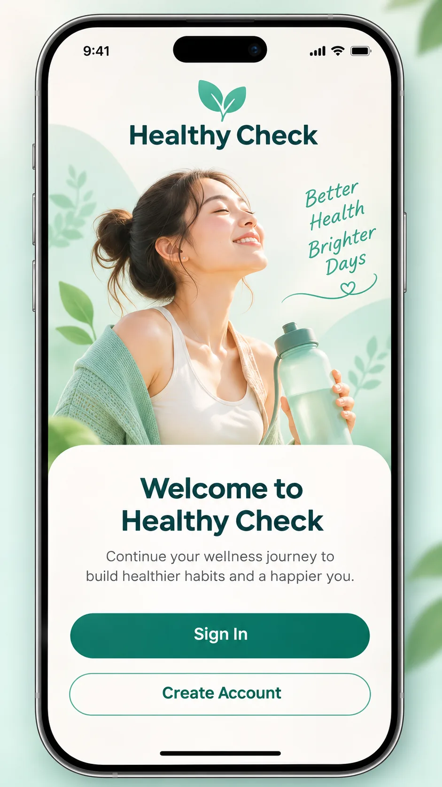
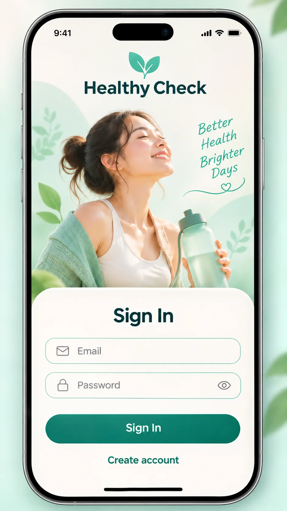
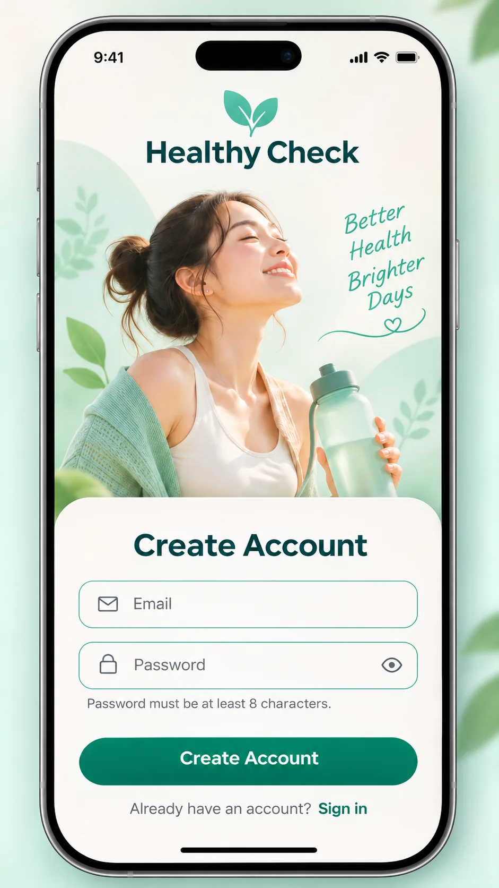
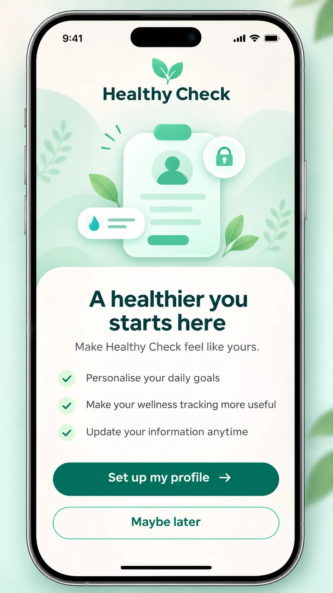

# Healthy Check — Authentication and Profile Handoff

**Visual status:** User-approved, four standalone screens. **Interaction status:** See [BEHAVIOR.md](BEHAVIOR.md).  
**Behavior standard:** [BEHAVIOR_STANDARD.md](../BEHAVIOR_STANDARD.md)

This module is reached from the final [introductory onboarding](../onboarding/README.md) slide. The entry view shows **Sign In** and **Create Account**. Selecting either slides the corresponding form **up as a rounded bottom sheet over the same hero background**. After successful registration and automatic sign-in, an optional profile-setup prompt appears.

## Approved screens

| Screen ID | Approved design | User-facing purpose |
| --- | --- | --- |
| `AUTH-SCR-001` |  | Welcome; choose Sign In or Create Account |
| `AUTH-SCR-002` |  | Enter email and password |
| `AUTH-SCR-003` |  | Register with email and password |
| `AUTH-SCR-004` |  | Offer profile setup or Maybe later |

**No extra authentication fields:** Registration has **Email + Password only**. No display name, confirm password, email OTP, Google/Apple sign-in, or Forgot Password in the MVP.

## Interaction and visual continuity

The first three screenshots intentionally reuse the same mint/cream hero, leaf brand mark and wellness lifestyle photo. Login and registration use the same white rounded sheet position and primary teal button. The profile-setup screen switches to a health profile illustration, while preserving the visual language and lower-card pattern.

[Full interaction contract and navigation flow](BEHAVIOR.md).

## Canonical business references

- [F1 Account Access — approved use cases and rules](https://github.com/vitaloom/vitaloom-business-docs-and-tools/tree/main/docs/usecase_spec/authentication/f1-account-access)
- [F2 Session Control](https://github.com/vitaloom/vitaloom-business-docs-and-tools/tree/main/docs/usecase_spec/authentication/f2-session-control)
- [Personal Health Profile](https://github.com/vitaloom/vitaloom-business-docs-and-tools/tree/main/docs/usecase_spec/personal-health-profile)

**Source-of-truth principle:** Image previews are *UI references*; validation rules and session lifecycle remain owned by the corresponding approved BR/UC and the actual backend API contract. A design approval is not proof that the frontend/API was implemented.

**PNG originals:** included in the generated image handoff archive; repository copies are optimized WebP from the same user-approved screens.
