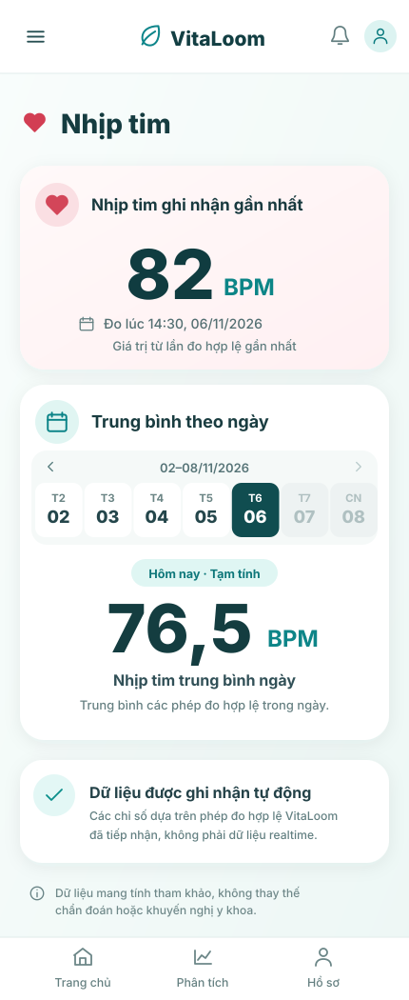
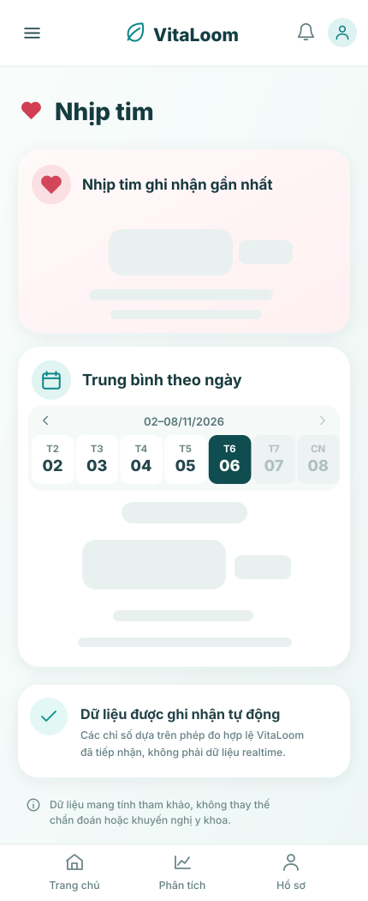
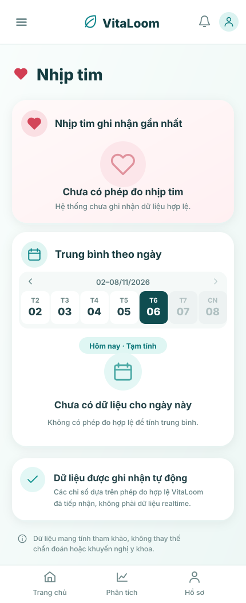
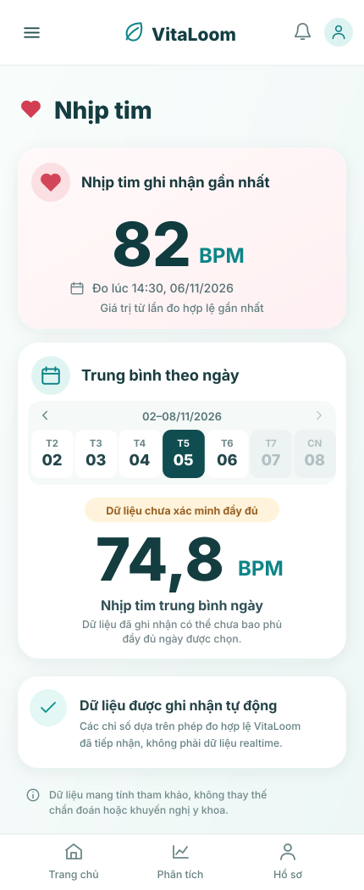
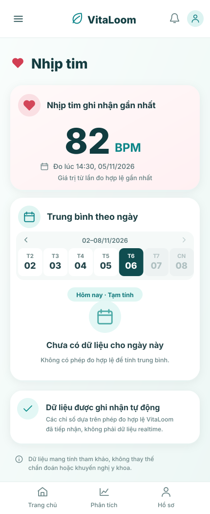
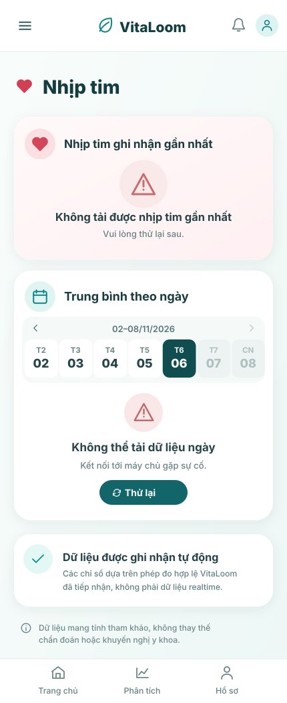

# Heart Rate Screen — Approved MVP Design

**Status:** Design reference for full-vertical-slice implementation  
**Shared navigation:** [Health Metrics Sidebar](../shared/health-metrics-sidebar/README.md) — **closed by default**; the menu button opens the shared drawer. The drawer is **not** duplicated inside this feature.  
**API source of truth:** [vitaloom-backend API Contract](https://github.com/vitaloom/vitaloom-backend/blob/main/docs/api/api-contract.md)  
**Persistence:** [Heart Rate Data Model](https://github.com/vitaloom/vitaloom-backend/blob/main/docs/architecture/heart-rate-data-design.md)  
**Business rules:** [Automated Health Metrics](https://github.com/vitaloom/vitaloom-business-docs-and-tools/tree/main/docs/usecase_spec/automated-health-metrics), [Health Insights Reports](https://github.com/vitaloom/vitaloom-business-docs-and-tools/tree/main/docs/usecase_spec/health-insights-reports)

## Screen assets

| Reference image | State | Display semantics |
| --- | --- | --- |
|  | [`default.svg`](default.svg) | Latest recorded observation + today’s provisional Daily Average |
|  | [`loading.svg`](loading.svg) | Skeleton for API-derived values, while navigation/static information remains visible |
|  | [`no-data.svg`](no-data.svg) | No accepted measurements anywhere; both independent metrics are empty |
|  | [`historical-unverified.svg`](historical-unverified.svg) | Past-day average flagged as unverified; Latest remains independent |
|  | [`daily-no-data.svg`](daily-no-data.svg) | Latest has a recorded value, but selected day has no measurements |
|  | [`error.svg`](error.svg) | Distinct API failure; present retry rather than misleading null/no-data |

All images are self-contained **editable SVG vector illustrations**, rendered on a clean flat canvas. They deliberately contain **no phone mockup, chalk border, fake ECG, realtime badge or invented connected-device status**. They are design references, not runtime source code; numbers and instants in these drawings are sample fixtures.

## Approved layout

1. **Header and shared app shell** — the hamburger opens the common Sidebar. The Sidebar is **closed by default**, and no feature-specific Sidebar is implemented.
2. **Card 1: “Nhịp tim ghi nhận gần nhất”** — prominent `latestRecorded.heartRateBpm`, `latestRecorded.occurredAt` converted to local display time, and a caption noting it is the latest **recorded** measurement.
3. **Card 2: “Trung bình theo ngày”** — current week/day navigation (only today and past days selectable), selected date, `dailyAverage.heartRateBpm`, and data-completeness status.
4. **Information and disclaimer** — static content, not dependent on the HR API; no medical judgment.

The example calendar shows **02–08 November 2026** with **Friday 06/11/2026** as today. Thursday 05/11/2026 is used for the historical example. The demo clock/day is illustrative; runtime must derive today's date in `Asia/Ho_Chi_Minh`. Weekday/date labels must be calculated, **not hardcoded**. Future dates are disabled.

## API mapping

`GET /api/heart-rate/summary?date=YYYY-MM-DD` (Bearer access token; optional `date` defaults to local today).

| API response property | UI element | Rules |
| --- | --- | --- |
| `latestRecorded.heartRateBpm` | Latest BPM value | Value from the latest accepted measurement across all account history, **independent** of chosen date |
| `latestRecorded.occurredAt` | “Đo lúc …” | Actual measurement timestamp in local display time; never display request/receipt time as measurement time |
| `dailyAverage.heartRateBpm` | Daily BPM value | Unweighted mean of accepted samples for **selected local day**; may be `null` |
| `dailyAverage.dataStatus` | Status badge and explanatory line | Mapping below |
| `date` | Selected date / calendar context | Should match requested local date |
| `timezone` | Day boundary rule | `Asia/Ho_Chi_Minh` |
| `asOf` | Optional diagnostic/read metadata | Must not be presented as a measurement timestamp |

### Status mapping

| API value | UX label | Meaning |
| --- | --- | --- |
| `CURRENT_DAY_PARTIAL` | **Hôm nay · Tạm tính** | Today’s mean is provisional, even when there is no accepted sample yet |
| `HISTORY_UNVERIFIED` | **Dữ liệu chưa xác minh đầy đủ** | Past-day data coverage is not proven complete, even if a number exists |
| `HISTORY_VERIFIED` | **Đã xác minh** (or no caution badge) | Show **only if** the backend explicitly sends this state; do not infer from the date |

### No-data and error behavior

- `latestRecorded: null`: show **“Chưa có phép đo nhịp tim”** instead of **0 BPM**.
- `dailyAverage.heartRateBpm: null`: show **“Chưa có dữ liệu cho ngày này”**; retain the date/status context independently of Latest.
- These states are **independent**. Latest may be non-null when today's Daily Average is null (illustrated by `daily-no-data.svg`).
- If the API request fails, render a distinct error/retry UI, **never** treat network/server errors as no data.
- On a date change, retain the Latest card value already loaded if appropriate, while Daily Average shows request/loading progress. Reject/disable future dates in the picker.
- Loading applies to **API-dependent** fields. Do not skeleton the static information card or disclaimer.
- Do not infer the user's health status from a numeric BPM.

## Behavior and data

- Tap a date: query the summary API with the selected `YYYY-MM-DD` and rerender Daily Average.
- While the API returns both metrics, the selected date logically scopes **only Daily Average**; Latest remains the newest accepted observation across the authenticated account.
- Navigate prior/next weeks as supported; don't allow future days.
- Handle a late-arriving measurement with older `occurredAt` without incorrectly replacing Latest.
- No realtime streaming, ECG waveform, device-connect indication, goals, HRV, resting HR, alerts, trends or min/max is part of this MVP.

## Visual design tokens

| Item | Reference |
| --- | --- |
| Artboard | `430 × 1050` mobile-portrait **illustration**, no device bezel |
| Primary teal | `#0D7579` |
| Main text | `#153C40` |
| Background | `#F5FBFA` with subtle light tint |
| Card | `#FFFFFF`, soft low-opacity shadow, radius ~26px |
| Latest card | Soft blush `#FFF0F2` |
| Heart icon | Coral `#D34659` |
| Selected day | Deep teal `#104D50` |
| Current-day badge | Teal on `#DFF6F3` |
| Unverified badge | Amber on `#FFF3DB` |
| Typography | Existing VitaLoom app sans-serif; SVG uses Inter/system sans fallback |
| Spacing | ~20–24px screen margins; generous card whitespace |

**Important:** API contract/business rules take precedence over illustrative sample values, and the app’s existing frontend design system takes precedence where tokens already exist. Do not rebuild or hardcode the SVGs into app UI; implement real components.

## Implementation handoff

- **Frontend Agent:** reuse shared drawer already specified under `shared/`; implement Heart Rate page + status variants + calendar + API client integration; follow the app’s real component and route structure.
- **Backend Agent:** implement the approved batch ingestion and account-scoped summary endpoint according to the canonical API/data-model documents; the design repo does **not** change backend contracts.
- **Orchestrator:** check integration between both agents, particularly authentication, latest-by-`occurredAt`, historical status, dates and independent null states.

This design addition is a **reference deliverable**, not proof of a deployed or tested Heart Rate API.
