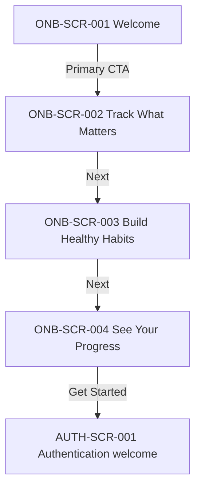

# Onboarding — Screen Behavior

> **Status:** APPROVED VISUAL / DOCUMENTED INTERACTIONS; individual UX suggestions explicitly marked PROPOSED.  
> **Scope:** Four introductory landing screens and handoff to Authentication.  
> **Behavior standard:** [BEHAVIOR_STANDARD.md](../BEHAVIOR_STANDARD.md)  
> **Authentication:** [Authentication behavior](../authentication/BEHAVIOR.md)

## 1. Screen registry and entry/exit

| ID | Image | Entry | Exit |
| --- | --- | --- | --- |
| `ONB-SCR-001` | [01-welcome.webp](01-welcome.webp) | Intro sequence starts | Continue to `ONB-SCR-002` |
| `ONB-SCR-002` | [02-track-what-matters.webp](02-track-what-matters.webp) | From page 1 | Continue to `ONB-SCR-003` |
| `ONB-SCR-003` | [03-build-healthy-habits.webp](03-build-healthy-habits.webp) | From page 2 | Continue to `ONB-SCR-004` |
| `ONB-SCR-004` | [04-see-your-progress.webp](04-see-your-progress.webp) | From page 3 | Finish intro → `AUTH-SCR-001` |

## 2. Flow

See [AUTH-SCR-001 — Authentication hub](../authentication/README.md#approved-screens) for the next design.

## 3. Interaction contract

| Action ID | Page / control | User action | UI response and destination | Status |
| --- | --- | --- | --- | --- |
| `ONB-ACT-001` | Page 1 / primary CTA | Tap | Advance to `ONB-SCR-002`, page dot 2 active | INTENDED FLOW |
| `ONB-ACT-002` | Page 2 / Next | Tap | Advance to `ONB-SCR-003`, page dot 3 active | INTENDED FLOW |
| `ONB-ACT-003` | Page 3 / Next | Tap | Advance to `ONB-SCR-004`, page dot 4 active | INTENDED FLOW |
| `ONB-ACT-004` | Page 4 / Get Started | Tap | Complete intro, open `AUTH-SCR-001` | CONFIRMED BY USER |
| `ONB-ACT-005` | Page indicators | Page changes | Reflect current page, do not change without corresponding page change | INTENDED FLOW |
| `ONB-ACT-006` | Horizontal gesture | Swipe left/right | Move by one page within bounds; keep CTA and active dot synchronized | PROPOSED |
| `ONB-ACT-007` | System Back | Back from page 2–4 | Return to previous page; on page 1 follow platform/app exit policy | PROPOSED |

**No Skip control appears in approved screens.** Do not silently add one without a design decision.

## 4. UI states, transitions and accessibility

- **Default:** one full screen visible, selected dot matches its index (1–4), all buttons remain reachable.
- **During animation:** optional smooth horizontal transition. Prevent fast repeated taps from skipping slides or opening multiple auth screens (PROPOSED).
- **At boundaries:** swipes beyond first/last slide do not wrap around (PROPOSED).
- **If the app is already authenticated:** session restoration and entry routing belong to Authentication/F2 rather than this introductory carousel; avoid overriding a valid session. The exact repeat-on-launch policy is OPEN.
- **Accessibility:** provide announcement of page number + title (e.g. “Onboarding, page 2 of 4”), accessible CTA labels, and a non-gesture way to progress. Respect reduced motion and safe areas.

## 5. Text/image discrepancy to resolve

**ONB-UX-OPEN-001:** The approved image for **page 1** currently labels the primary CTA **“Get Started”**, while its intended action in the four-step carousel is **Next page**. Preserve the approved visual as-is until a UI copy update is accepted; do not bypass screens 2–4 because of this label. Recommendation: use “Next” for pages 1–3 and “Get Started” only on page 4.

**ONB-UX-OPEN-002:** Define whether this intro is first-launch-only, repeats after logout, or is controlled by a first-run flag. Do not confuse this with optional *health-profile onboarding* after authentication.

**ONB-UX-OPEN-003:** Decide whether page dots are clickable or only indicators. The current contract assumes indicators only.

## 6. Acceptance criteria

- [ ] Four distinct slides are shown in order with the approved illustrations and consistent top/bottom composition.
- [ ] CTA on pages 1–3 advances exactly one page; CTA on page 4 opens `AUTH-SCR-001`.
- [ ] Dot state tracks slide index, and no future slide is displayed by default.
- [ ] Every user can complete the flow without swiping.
- [ ] Authentication form is not shown until intro completion.
- [ ] UX copy mismatch and first-launch policy are resolved before claiming final sign-off.

## 7. Visual provenance

All images are optimized WebP copies extracted from the selected four-screen onboarding design. No business rules have been inferred from illustration values.

## 8. Visual asset mapping (non-behavioral)

The [asset mapping contract](ASSET_MAPPING.md) links each stable screen ID and approved WebP mockup to its new, transparent SVG hero and decorative landscape. The SVGs are separate vector illustrations for visual review; they do **not** change entry/exit conditions, the intended CTA sequence or the UX open questions above.

| Screen | Full-screen reference | Hero artwork | Background hills and waves |
| --- | --- | --- | --- |
| `ONB-SCR-001` | [01-welcome.webp](01-welcome.webp) | [welcome-hero.svg](../assets/onboarding/welcome-hero.svg) | [welcome-landscape.svg](../assets/onboarding/welcome-landscape.svg) |
| `ONB-SCR-002` | [02-track-what-matters.webp](02-track-what-matters.webp) | [track-hero.svg](../assets/onboarding/track-hero.svg) | [track-landscape.svg](../assets/onboarding/track-landscape.svg) |
| `ONB-SCR-003` | [03-build-healthy-habits.webp](03-build-healthy-habits.webp) | [habits-hero.svg](../assets/onboarding/habits-hero.svg) | [habits-landscape.svg](../assets/onboarding/habits-landscape.svg) |
| `ONB-SCR-004` | [04-see-your-progress.webp](04-see-your-progress.webp) | [progress-hero.svg](../assets/onboarding/progress-hero.svg) | [progress-landscape.svg](../assets/onboarding/progress-landscape.svg) |

The white rounded information panel, copy, pagination and CTA remain native UI rather than image assets. Decorative assets are not interactive controls. **Do not claim that this redraw matches approved artwork pixel-for-pixel or that visual review is complete.**

## 9. Change log

- 2026-11-10 — Initial four-screen behavior mapping and approved image handoff.
- 2026-11-10 — Added screen-to-transparent-asset links (documentation only; no flow change).
