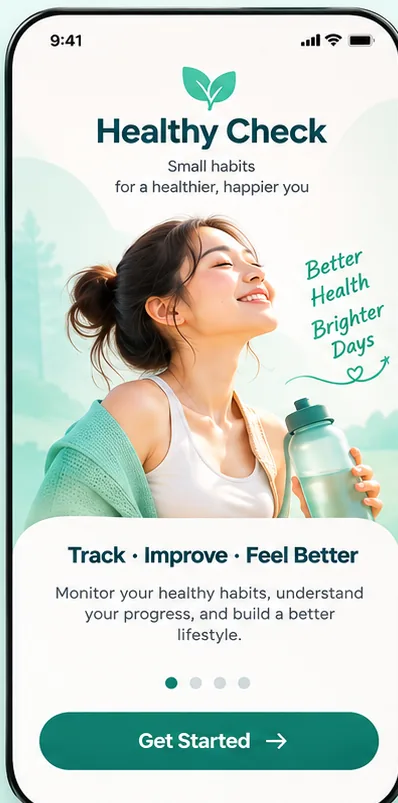
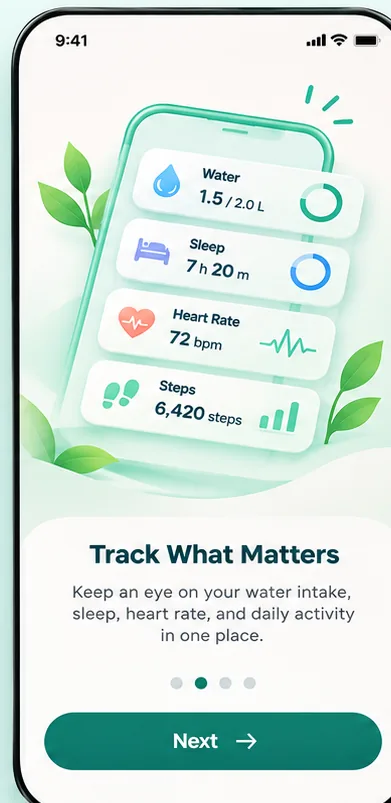
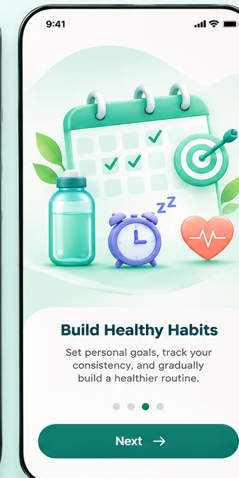
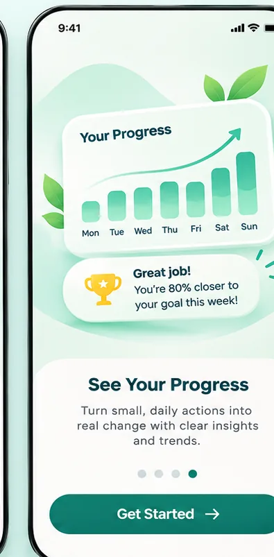

# Healthy Check — First-Launch Onboarding

**Visual status:** User-approved, four screens. **Behavior status:** See [BEHAVIOR.md](BEHAVIOR.md) for explicit interaction decisions and open questions.

This is the **introductory carousel before authentication**. It is not the Personal Health Profile setup offered after sign-up. The approved screens use the common visual structure: **hero image above + rounded white text and CTA section below**.

## Approved screens

| Screen ID | Design | Message |
| --- | --- | --- |
| `ONB-SCR-001` |  | Track · Improve · Feel Better |
| `ONB-SCR-002` |  | Track What Matters |
| `ONB-SCR-003` |  | Build Healthy Habits |
| `ONB-SCR-004` |  | See Your Progress |

[View all four approved screens in one image](onboarding-approved-overview.webp).

## Design contract

- Consistent warm white/cream + mint background, decorative leaves, soft illustrations and deep teal action button.
- Same vertical hierarchy on all four screens: hero art, lower rounded white surface, title, supporting copy, pagination dots, bottom CTA.
- Image content illustrates benefits, not live or device-connected health data.
- UI copy and numerical health examples in the images are illustrative, not application state.

## Related flow

[Behavior and transition matrix](BEHAVIOR.md) → [Authentication entry](../authentication/README.md) → optional [Personal Health Profile](https://github.com/vitaloom/vitaloom-business-docs-and-tools/tree/main/docs/usecase_spec/personal-health-profile).

**Assets policy:** these WebP files are complete screen designs, **not** transparent component assets. Extracted leaves/icons/bottles belong in `../assets/shared/` or feature-specific `../assets/` subfolders only when separately exported.

**PNG originals:** preserved in the handoff archive generated alongside this upload; the GitHub copies are optimized WebP renders of the same approved images.
