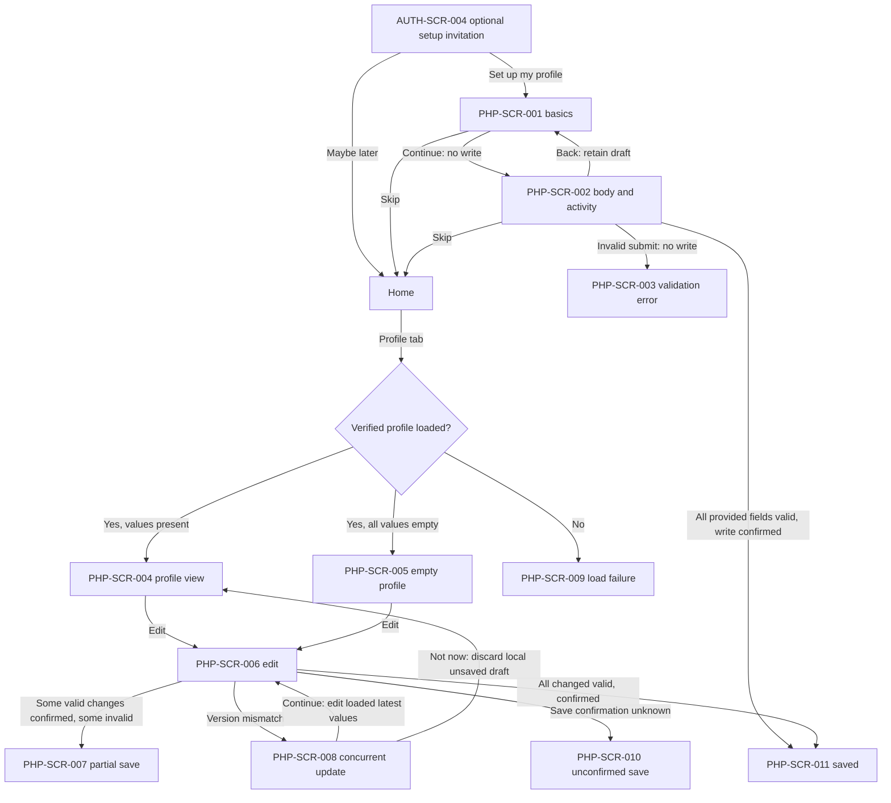

# Personal Health Profile — Behavior contract (UI proposal)

**UI status:** `PROPOSED`; business conditions listed below are confirmed in the `main` branch. This does not claim API or frontend implementation.

## User flows

The F1 visual progression is not a commit. The two steps represent a single optional form and an atomic submission.

## Interaction contracts

| Action ID | Event and expected response | Business source |
|---|---|---|
| PHP-ACT-001 | First profile invitation is optional. Skip does not force onboarding again. | BR-F1.8 |
| PHP-ACT-002 | Setup validates **every provided field**. Any invalid field blocks the **whole** creation, shows inline error and preserves form draft. | BR-F1.2, BR-F1.5, BR-F1.6, BR-F1.10 |
| PHP-ACT-003 | Setup save with every field truly empty equals Skip. Invalid value does not equal Skip. | BR-F1.9 |
| PHP-ACT-004 | A user/account has at most one profile. Creation losing a cross-device race must not overwrite; redirect to current profile. | BR-F1.1 |
| PHP-ACT-005 | On verified Profile load, show all six fields; blank when not supplied, with direct edit even after onboarding skip. | BR-F2.5, BR-F2.14–F2.15 |
| PHP-ACT-006 | Edit any field, including explicitly clearing a prior value or clearing all six. Do not force onboarding on next login. | BR-F2.4, BR-F2.8 |
| PHP-ACT-007 | On F2 Save, compare with latest version; only explicitly modified valid fields can be written. If valid and invalid changes coexist, confirmed valid changes can be stored and invalid fields keep their previously stored values; show **partial save** and inline errors. | BR-F2.6, BR-F2.10 |
| PHP-ACT-008 | With zero edited fields, do not write and say “No changes”. All-invalid edits are errors, not “No changes”. | BR-F2.11 |
| PHP-ACT-009 | If any profile data changed elsewhere since edit-load, **save nothing** for this attempt; load newest and offer Continue/Not now. Continue uses fresh values, never automatically reapplies stale draft; next Save checks version again. | BR-F2.6, BR-F2.16 |
| PHP-ACT-010 | If data freshness cannot be verified, display explicit load error/retry; do not show a false empty profile. | BR-F2.13 |
| PHP-ACT-011 | If server save acknowledgement is uncertain, do **not** claim success or definite failure; keep draft if possible and verify latest state before retrying. | BR-F1.11, BR-F2.7 |
| PHP-ACT-012 | Normal navigation away discards only *unsaved* changes without warning. Explicit logout with draft follows Authentication confirmation, not this shortcut. | BR-F1.10, BR-F2.9, BR-F2.12 |
| PHP-ACT-013 | Saving/changing/clearing profile never silently changes Water/Sleep goals. | BR-M.3, BR-F2.3 |

## Validation

All six inputs are optional. If provided: display name is trimmed and has length 1–50; birth year is integer 1900–current year; height 20–300 cm; weight 0.3–500 kg; gender has four approved values plus unset; activity has four self-selected levels plus unset. No medical history, jobs, clinical diagnosis or goal recalibration.

## Visual status and remaining FE details

- Status of all images: `PROPOSED / PENDING_VISUAL_ACCEPTANCE`.
- Exact API routes, concurrent-update detection (version/ETag/etc.), navigation route keys, keyboard-aware input rendering, and `Clear selection` controls remain technical/UX implementation decisions.
- Error text should be accessible and associated with its field. Native controls require safe-area, focus/keyboard and minimum touch-target handling.
- Existing authentication and app shell remain separate. A person with an expired/revoked authentication session is routed by Authentication, not silently treated as a network error.
- Privacy/compliance review for users of all ages remains required before production launch.