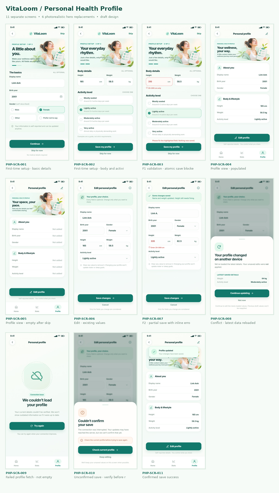

# VitaLoom — Personal Health Profile

**Visual status:** `PROPOSED / PENDING_VISUAL_ACCEPTANCE`. The user selected the realistic, text-free mint/cream header artwork for this design revision. The eleven rendered screens are UI references, not implemented frontend features.

**Domain sources:** [Personal Health Profile scope](https://github.com/vitaloom/vitaloom-business-docs-and-tools/blob/main/docs/usecase_spec/personal-health-profile/00-module.md) · [F1 Business Rules](https://github.com/vitaloom/vitaloom-business-docs-and-tools/blob/main/docs/usecase_spec/personal-health-profile/f1-profile-onboarding/rules.md) · [F2 Business Rules](https://github.com/vitaloom/vitaloom-business-docs-and-tools/blob/main/docs/usecase_spec/personal-health-profile/f2-profile-management/rules.md).

**Design standards:** [BEHAVIOR_STANDARD](../BEHAVIOR_STANDARD.md) · [ASSET_MAPPING_STANDARD](../ASSET_MAPPING_STANDARD.md).

## Preview

## Screen catalog

| Screen ID | Screenshot | Scenario | Use Case | Hero |
|---|---|---|---|---|
| `PHP-SCR-001` | [01-profile-setup-basics](./01-profile-setup-basics.png) | First-time setup · basic details | `PHP-UC-001` | Yes |
| `PHP-SCR-002` | [02-profile-setup-lifestyle](./02-profile-setup-lifestyle.png) | First-time setup · body and activity | `PHP-UC-001` | Yes |
| `PHP-SCR-003` | [03-setup-validation-error](./03-setup-validation-error.png) | F1 validation · atomic save blocked | `PHP-UC-001` | Yes |
| `PHP-SCR-004` | [04-profile-overview](./04-profile-overview.png) | Profile view · populated | `PHP-UC-002` | Yes |
| `PHP-SCR-005` | [05-profile-overview-empty](./05-profile-overview-empty.png) | Profile view · empty after skip | `PHP-UC-002` | Yes |
| `PHP-SCR-006` | [06-profile-edit](./06-profile-edit.png) | Edit · existing values | `PHP-UC-003` | No |
| `PHP-SCR-007` | [07-edit-partial-save](./07-edit-partial-save.png) | F2 · partial save with inline error | `PHP-UC-003` | No |
| `PHP-SCR-008` | [08-concurrent-update](./08-concurrent-update.png) | Conflict · latest data reloaded | `PHP-UC-003` | No |
| `PHP-SCR-009` | [09-profile-load-error](./09-profile-load-error.png) | Failed profile fetch · not empty | `PHP-UC-002/003` | No |
| `PHP-SCR-010` | [10-save-unconfirmed](./10-save-unconfirmed.png) | Unconfirmed save · verify before retry | `PHP-UC-001/003` | No |
| `PHP-SCR-011` | [11-profile-save-success](./11-profile-save-success.png) | Confirmed save success | `PHP-UC-001/003` | Yes |

**Resolution:** each screenshot is 1170 × 2532 px (3× 390 × 844 reference layout).

## F1/F2 business differences that must survive implementation

- F1 setup is optional and two **visual** steps share one local draft; selecting Continue does not save. Saving the provided values is **atomic**: one invalid input prevents all writes. Saving a truly empty form is Skip. Never create a second profile.
- F2 read shows all six fields even when every value is unset. A load error is not interpreted as an empty profile.
- F2 update sends only intentionally changed fields, including explicit clears. It can confirm **partial success** for valid fields while retaining invalid edits and inline errors.
- F2 does not auto-merge or overwrite on concurrent edits. After reloading latest data, the user must intentionally choose to continue editing **that refreshed state**; do not replay stale drafts.
- Neither a skipped/empty profile nor clearing every field blocks Water/Sleep; profile edits never silently modify those modules’ goals.

## Implementation handoff

- [BEHAVIOR.md](BEHAVIOR.md) defines navigation, states, validation/error recovery and approved-vs-proposed decisions.
- [ASSET_MAPPING.md](ASSET_MAPPING.md) documents the six hero-bearing screens and the remaining no-hero states.
- [screen-manifest.json](screen-manifest.json) records stable Screen IDs, source and artwork paths.
- [Reusable poster (no text)](../assets/personal-health-profile/profile-hero-photorealistic.png) and [asset inventory](../assets/personal-health-profile/README.md).
- [Editable visual sources](source/README.md) are HTML/CSS reference renders; they are **not** production React Native code.
- The rendered PNGs include sample health values and UI labels for review. Render text and data using native Expo/React Native components, never display a whole screenshot as a functional screen.

## Relationship to the existing design

After successful sign-in/signup where the first-time proposal is eligible, the existing [`AUTH-SCR-004`](../authentication/BEHAVIOR.md) leads to `PHP-SCR-001`. "Maybe later" goes to Home. Introductory onboarding before auth is a separate flow. The AppShell/profile tab and shared navigation are owned outside this module; do not duplicate shared navigation implementations.

## Visual acceptance / release

These designs are **candidate references** pending explicit UI acceptance and Expo device verification. Domain rules are approved independently; privacy and consent review for all ages is still required before product release.