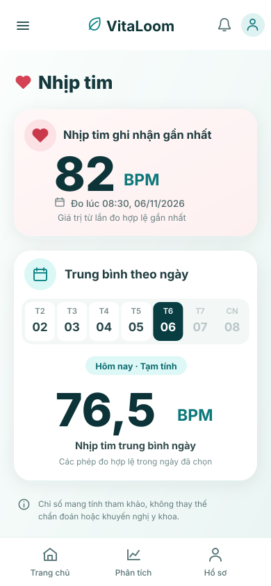
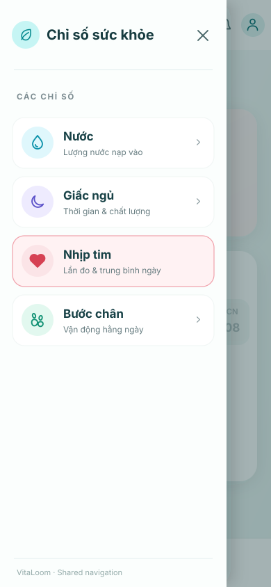
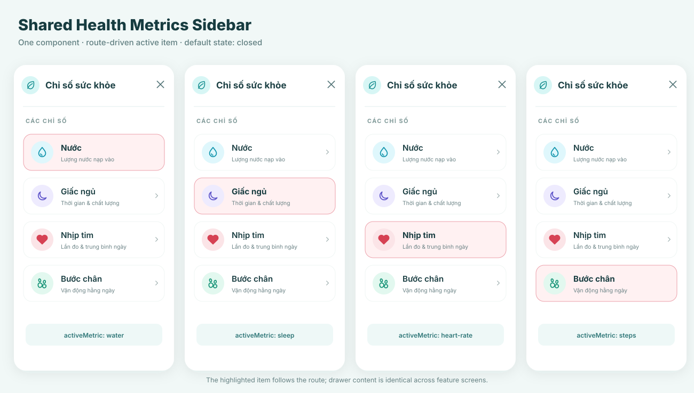

# Health Metrics Sidebar — Shared Component Design Specification

**Status:** Design baseline for frontend implementation. **Behavior agreed:** collapsed/closed by default, user-controlled toggle.  
**Scope:** Health Metrics navigation drawer only; reusable for Water, Sleep, Heart Rate and Steps.  
**Ownership:** Shared app shell; not owned by Heart Rate, Water, Sleep or Steps.

## Visual references

| Preview | File | Purpose |
| --- | --- | --- |
|  | [sidebar-closed.svg](sidebar-closed.svg) | **Default app state**: the feature fills the screen, hamburger toggle is visible |
|  | [sidebar-open.svg](sidebar-open.svg) | Open overlay with focus on metric navigation, Heart Rate active |
|  | [sidebar-active-states.svg](sidebar-active-states.svg) | Same drawer component across four metrics, route-driven active state |

SVGs are **editable vector visual references**, not generated UI source code. Mock BPM values and dates are illustrative; runtime values come from the relevant API.

## Component composition

```text
AppShell
├─ Shared App Header
│  └─ Menu toggle (hamburger; opens drawer)
├─ HealthMetricsDrawer (shared, initially CLOSED)
│  ├─ Header: "Chỉ số sức khỏe" + close button
│  ├─ MetricNavigation
│  │  ├─ Water
│  │  ├─ Sleep
│  │  ├─ Heart Rate
│  │  └─ Steps
│  └─ Backdrop (visible only when open)
├─ FeatureContent (Water | Sleep | Heart Rate | Steps)
└─ Shared BottomNavigation
```

**Only one drawer component exists.** The current route selects `activeMetric`; page content components do not duplicate the sidebar.

## Interaction contract

| Trigger | Expected behavior |
| --- | --- |
| Initial visit / fresh app navigation | Drawer is **closed**; main feature content is unobstructed |
| Tap the hamburger button | Open drawer as a modal overlay over the current page |
| Tap the X button inside the drawer | Close drawer; keep the current page |
| Tap the backdrop outside the drawer | Close drawer; keep the current page |
| Press Escape (web) / Back (mobile) while open | Close drawer before navigating away |
| Select a metric item | Navigate to corresponding metric route and **close** drawer; active item follows the route |
| Open on a different metric page | Reuse the identical drawer, highlight only the matching item |
| Tap the currently active item | Stay on the same metric; close drawer |
| Select a date in a feature (e.g. Daily Heart Rate) | Does not open the drawer or alter its active item |

Drawers are **not permanently expanded** on the default layout. No invented connected-device state is displayed in the drawer or footer.

## Navigation entries

| Key | Display label | Helper text | Icon |
| --- | --- | --- | --- |
| `water` | Nước | Lượng nước nạp vào | Droplet |
| `sleep` | Giấc ngủ | Thời gian & chất lượng | Moon |
| `heart-rate` | Nhịp tim | Lần đo & trung bình ngày | Heart |
| `steps` | Bước chân | Vận động hằng ngày | Footprints |

The route mapping is resolved by the frontend's existing navigation system; this repository does not invent definitive application URLs.

## Visual tokens (reference dimensions for mobile)

| Token | Value / behavior |
| --- | --- |
| Reference artboard | `390 × 844` px; SVG scales responsively |
| Drawer width | `min(326px, 86vw)` |
| Drawer position | Fixed / overlay from left edge |
| Page background | `#F5FBFA` |
| Drawer background | `#FBFEFD` |
| Surface/card | `#FFFFFF` |
| Main text | `#173C40` |
| Secondary text | `#657B7F` |
| Primary teal | `#0D7579` |
| Mint icon background | `#DFF7FC` / `#D7F6F5` |
| Heart icon accent | `#D64153` |
| Active background | `#FFF2F3` |
| Active border | `#F0A0AA` |
| Backdrop | `#092E30` at `37%` opacity |
| List item | `73px` high, `17px` corner radius, at least 44px touch target |
| Item icon container | Circular, approx. `46px` |
| Drawer edge shadow | Soft neutral shadow; **no black/chalk/textured frame** |
| Typeface | App's existing sans-serif; SVG uses system fallback fonts |

The primary accent of active navigation is subtle blush/coral as in the original VitaLoom references. Other metric icons retain their respective gentle colors. Status words such as "Đang theo dõi", "Theo dõi liên tục", "Live" and device-connect claims **must not** be introduced by this shared component.

## Component states

1. **Closed (default):** only the shared header menu toggle remains visible; feature content is fully readable and interactive.
2. **Open:** drawer and accessible close button are visible; a translucent backdrop dims the feature screen.
3. **Active metric:** exactly one active item based on current route; selected item has a blush background, thin coral border and highlighted icon.
4. **Focus / keyboard:** provide a visible focus treatment independent of active styling; menu and close buttons are keyboard operable.
5. **Transition:** use a short, optional slide-in/out animation. Respect reduced-motion settings. No animation is required for correctness.

## Accessibility and implementation notes

- Hamburger button: accessible label **"Mở chỉ số sức khỏe"**, `aria-expanded` reflects drawer state, and `aria-controls` points at the drawer.
- Drawer close control: **"Đóng chỉ số sức khỏe"**. The open drawer should have a navigation/dialog label.
- While open, manage focus inside the drawer, restore focus to the opener on close, and prevent accidental interaction with underlying content.
- Use semantic navigation items with clear active-current indication. Color alone should not identify the selected item.
- Keep the app's own user/session logic. Do **not** add a separate account or device-connect flow to the sidebar.
- Feature pages should not embed sidebar artwork: import the **same implemented drawer** in the app's shared shell.
- Images intentionally use a **flat canvas with no hardware outline, chalk border, phone mockup, or decorative black texture**.

## Heart Rate integration (approved MVP)

Heart Rate page renders **Latest Recorded HR** and **Daily Average HR** in two stacked cards within `FeatureContent`. The date selector controls **only** Daily Average. No ECG, realtime, resting HR, alert state or connected wearable is implied by the drawer design.

The feature API contract is maintained in `vitaloom-backend/docs/api/api-contract.md`; this shared drawer has no health-metric data fetching responsibility.
