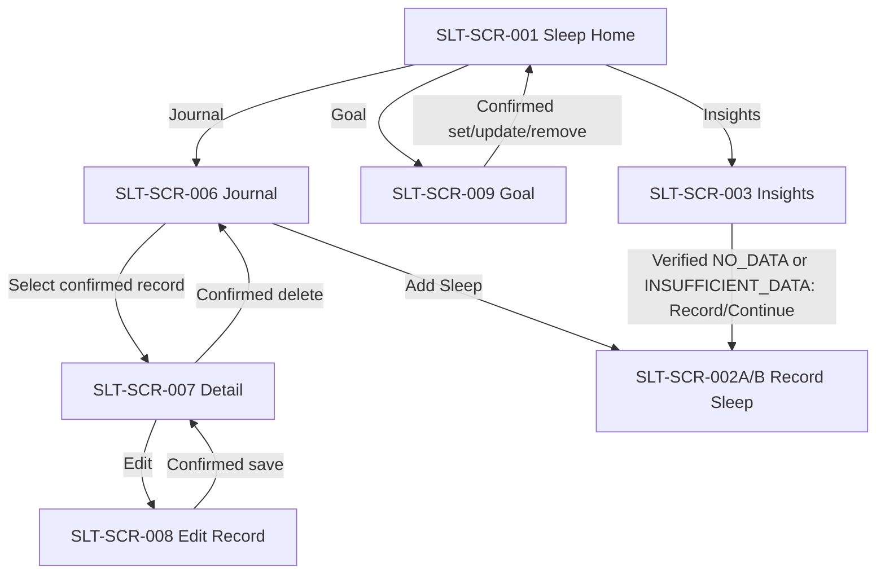

# Sleep Tracking — Additional screen & asset specification (2026-11-11)

> Source: [fba900f](https://github.com/vitaloom/vitaloom-design/commit/fba900f84fccdc203f11feaa514b7e4e3a0e4aef) — six new screen PNGs; [7dd2fa9](https://github.com/vitaloom/vitaloom-design/commit/7dd2fa987116642477310f4631e1b084e4c7005f) — two standalone illustration PNGs.
>
> **MANDATORY — DESIGN COLOR ERROR:** The new screenshots 7–12 incorrectly use **purple as the dominant screen color**. These files are **STRUCTURE_ONLY_COLOR_OVERRIDE_REQUIRED**, **not** approved visual-color baselines. FE must use the existing green/mint VitaLoom Soft Wellness primary palette for screen backgrounds, primary CTAs, selectors, active states, main titles, cards and overlays, with cream/neutral surfaces and adequate contrast. **Purple only as a restrained illustration/icon accent** (roughly 10% or less of visual emphasis). Never copy the large purple screen gradients/buttons. Preserve original PNGs as traceable structural references. Green FE implementations still require visual review.

## Screen and state registry

| Stable screen/state ID | New source image | Role/owner | Reference content to retain (NOT color) |
|---|---|---|---|
| `SLT-SCR-006` | [7_sleep_journal.png](7_sleep_journal.png) | Sleep Journal — SLT-UC-005 | date groups, session list/cards, sleep vs nap distinction, view detail, Add Sleep |
| `SLT-SCR-007` | [8_sleep_record_detail.png](8_sleep_record_detail.png) | Read-only Record Detail — SLT-UC-005/006/007 | record summary, stored fields, optional feeling, Edit and Delete actions |
| `SLT-SCR-008` | [9_sleep_record_detail_edit.png](9_sleep_record_detail_edit.png) | Edit Record — SLT-UC-006 | prefilled type/method/feeling, time inputs, Save/Cancel, reuse create-form validation |
| `SLT-SCR-009` | [10_sleep_goal_setup.png](10_sleep_goal_setup.png) | Sleep Goal — SLT-UC-008 | confirmed current goal, hour/minute controls, suggested goal note, Remove and Save |
| `SLT-SCR-003 / NO_DATA` | [11_sleep_insight_empty.png](11_sleep_insight_empty.png) | Existing Insights screen — SLT-UC-009 | tabs, verified empty-state message and Record Sleep action |
| `SLT-SCR-003 / INSUFFICIENT_DATA` | [12_sleep_not_enough_data_insight.png](12_sleep_not_enough_data_insight.png) | Existing Insights screen — SLT-UC-009 | tabs, insight-specific unmet evidence requirements, Continue Tracking |

**Important:** Screens 11/12 are UI **states of `SLT-SCR-003`**, not separate navigation routes. No universal “at least 3 recorded days” rule may be inferred from the PNG; eligibility is insight-specific (INS-S01–S04, A/B/C catalog), and some conditions need more than a count of days.

## Independently uploaded assets

| Source asset | Purpose | Color and use |
|---|---|---|
| [star-pillow-cloud.png](../assets/sleep-tracking/star-pillow-cloud.png) | Reusable combined moon/cloud/star/pillow hero for Journal, Detail, Edit, Insights empty/insufficient and optionally Goal | Composite illustration over **green wellness UI**, not a flattened screen screenshot; independent transparent asset |
| [bed.png](../assets/sleep-tracking/bed.png) | Small purple/lilac 3D bed in Journal/Detail/Goal or sleep type controls | Purple decorative icon **only**. Do not derive the screen theme from this asset. |

Both files were uploaded separately from the screenshots, in commit `7dd2fa9`. Use native functional text, charts, date fields, chips, buttons and cards. Never crop image assets from full-screen screenshots; preserve standalone source files. Verify alpha and sizing during actual FE import.

## Navigation and behavior additions

- **Journal:** show only confirmed records grouped by stored statistical day; verified empty is not 0h. Filter/calendar action is proposed and must respect actual supported queries.
- **Detail:** show duration, sleep type, optional feeling, method, and actually stored dates/timezone. **Duration-only has no inferred start/end clock timestamps**.
- **Edit:** preserve persisted reference timezone for time-range records; do not silently change it. Reuse form; enforce 1–1440 min per session, no future, DST resolution, overlap rejection and revision/conflict recovery. Unknown save outcome is not confirmed.
- **Delete:** confirmation required; cancel does not send; stale/deleted record requires reload and deliberate reconfirmation. No optimistic false success.
- **Goal:** 8 hours/day is a suggestion, not an active goal until saved. Enter X hours (1–24) and Y minutes (00/15/30/45), total 60–1440; 24h requires 00min. Remove requires confirmation; preserve historical goals.
- **Insights NO_DATA:** only after verified history read finds no relevant recorded sleep; auth/network/unknown are distinct from empty.
- **Insights INSUFFICIENT_DATA:** records exist but selected category/insight cannot satisfy the corresponding catalog policy. The screen's “3 recorded days” line is illustrative, not universal. Filter switching recomputes state.
- After confirmed edit/delete/goal mutation, refresh relevant journal, progress and insight evidence.

## Screenshot discrepancies that must not become rules

- In the Detail reference, the example may show a cross-midnight wake-up date while associating the record to the earlier day. The true statistical day is the **local end/wake date in the stored reference timezone** for timed records.
- The Journal reference displays “Ended at” clock on duration-only rows; **do not show a clock time** unless it exists as an authorized field.
- The Edit reference illustrates a timezone control; an already stored timed record's reference timezone **cannot be changed**.
- Goal values, percentages, feelings, calendar dates and insight conditions drawn in mockups are illustrative and cannot override business docs.

## Required FE acceptance gate

1. Do not reuse purple dominant background/title/button/card palette in any of the six new screens.
2. Apply the green wellness theme to normal, loading, empty, error, validation and confirmation states.
3. Use screen images only as **layout/content references**, independent PNGs only as decoration.
4. Implement Journal/Detail/Edit/Goal navigation and data validation from the canonical Sleep business specs.
5. Keep Insights empty/insufficient as states of screen 003 and source actual eligibility.
6. Mark green FE visual acceptance `PENDING_VISUAL_ACCEPTANCE` until reviewed; source PNGs existing in GitHub do not prove FE has been implemented.
