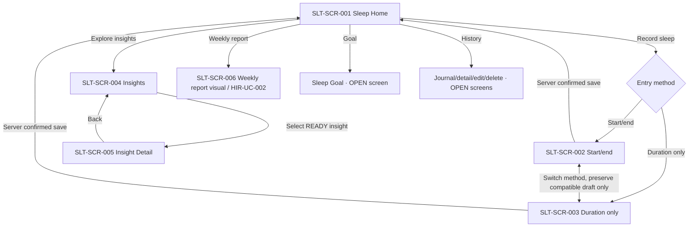

# Sleep Tracking — Screen behavior and interaction contract

**Documentation status:** `PROPOSED` UX interaction detail mapped to the six uploaded **baseline** images; **business invariants** below are sourced from the current Sleep F1/F2 and HIR specifications. The screenshots do not certify any implemented FE behavior.

[Screen catalog](README.md) · [Asset map](ASSET_MAPPING.md) · [Behavior standard](../BEHAVIOR_STANDARD.md) · [Sleep module scope](https://github.com/vitaloom/vitaloom-business-docs-and-tools/blob/main/docs/usecase_spec/sleep-tracking/00-module.md).

## 1. Ownership and screen registry

| Screen ID | Existing full-screen image | Entry | Exit / owner |
| --- | --- | --- | --- |
| `SLT-SCR-001` | [1_sleep_tracking_main_screen.png](./1_sleep_tracking_main_screen.png) | From Home/AppShell or Sleep metric tab | Entry forms / Insights / Journal / Goal / report |
| `SLT-SCR-002` | [2_record_start_end_time_sleep.png](./2_record_start_end_time_sleep.png) | From Home 'Record sleep' choosing start/end method | Save confirmed → Home/Journal; switch method; Back |
| `SLT-SCR-003` | [3_record_duration_sleep.png](./3_record_duration_sleep.png) | From entry method switch to duration-only | Save confirmed → Home/Journal; switch method; Back |
| `SLT-SCR-004` | [4_sleep_insights_screen.png](./4_sleep_insights_screen.png) | From Sleep Home/insight call to action | Insight Detail or Back |
| `SLT-SCR-005` | [5_insight-detail-screeen.png](./5_insight-detail-screeen.png) | From one READY insight in Insights | Back to list / optional AI explanation |
| `SLT-SCR-006` | [6_weekly_report_screen.png](./6_weekly_report_screen.png) | From the HIR weekly report entry/context | Week selector / Back to origin; HIR owns report navigation |

**No separate baseline exists** for the Journal/Session Detail/Edit/Delete, Sleep Goal, AI consent, and error/empty states. Implement as native destinations/overlays after UX review; any concrete route or new Screen ID is `OPEN`, not an invented image. Use existing [shared AppShell/sidebar](../shared/health-metrics-sidebar/README.md), rather than duplicating it inside Sleep.

## 2. Navigation intent

Destinations for Goal/Journal must be exposed through real UX controls only when designed/implemented. The report's select metric/week workflow remains in HIR. A screenshot's back arrow is not authority to create new app routes.

## 3. Visible actions and feedback

| Action ID | Screen/control | Trigger → immediate feedback | Result / alternate / failure | Status and source |
| --- | --- | --- | --- | --- |
| `SLT-ACT-001` | 001 / Record sleep | Tap → open recording method | 002 or 003; Back without server-confirmed save leaves Journal unchanged | `PROPOSED`; SLT-UC-004 |
| `SLT-ACT-002` | 002,003 / Method switch | Select start/end vs duration-only → change active fields; retain only compatible draft values | Switching never fabricates a start/end pair for duration-only; revalidate before Save | `CONFIRMED` rule, `PROPOSED` transition; BR-F1.1–3 |
| `SLT-ACT-003` | 002,003 / Session type | Choose Main Sleep or Nap; show selected state | Validate against all session policies; no implicit classification from duration | `CONFIRMED`; BR-F1.1 |
| `SLT-ACT-004` | 002 / Start + End + timezone | Native date/time picker and reference timezone; show duration only from a valid resolved interval | Require one consistent timezone, valid elapsed 1–1440 minutes, not future, not overlapping timed sessions; ambiguous/nonexistent DST time must be clarified | `CONFIRMED`; BR-F1.2/4/5/7–9 |
| `SLT-ACT-005` | 003 / Duration + end date | Enter estimated minutes and local end date (today suggested) | 1–1440 minutes, date not future; never infer a start/end time or overlap from duration-only | `CONFIRMED`; BR-F1.3/4/6/7/10 |
| `SLT-ACT-006` | 002,003 / Feeling selection | Choose Dễ chịu / Bình thường / Mệt mỏi, or leave unset; visually indicate selected control | Exactly one optional per-session feeling; can clear/change while editing; never infer clinical sleep quality | `CONFIRMED`; BR-F1.17, UX-D01/02 |
| `SLT-ACT-007` | 002,003 / Save | Validate inline, disable duplicate submit while pending, show progress | Server-confirmed → update Journal, Home progress and dependent insights; validation/network failure → preserve draft; sent request with lost response → **unconfirmed, reconcile before retry** | `CONFIRMED` persistence; `PROPOSED` feedback; BR-F1.12–15 |
| `SLT-ACT-008` | 001 / Recent sessions / Journal | Select or view history → open Journal/Detail (not yet pictured) | Show confirmed sessions grouped by **recorded end/statistical date**, preserving saved timezone. Duration-only shows estimated duration/end date, never invented times | `CONFIRMED`; SLT-UC-005, BR-F1.10–11 |
| `SLT-ACT-009` | Session Detail / Edit | Edit type, method, times/duration, feeling → inline validate | No overwrite on version conflict; reload latest and require user's fresh decision; keep stored timezone immutable for timed sessions | `CONFIRMED`; SLT-UC-006, BR-F1.13/17/18 |
| `SLT-ACT-010` | Session Detail / Delete | Tap Delete → **confirmation first** | Cancel = no request; changed session = reload and require fresh confirm; server-confirmed deletion updates derived data | `CONFIRMED`; SLT-UC-007, BR-F1.19 |
| `SLT-ACT-011` | 001 / Sleep Goal | Open goal form, show current effective goal or nonactive **8h suggestion** | Enter X hours + Y minutes (0,15,30,45), 1–24 h total, 24:00 max; saving/removal requires active choice + confirmed response, historical goals preserved | `CONFIRMED`; SLT-UC-008, BR-F2.5/6/9 |
| `SLT-ACT-012` | 001 / Progress card | Display confirmed daily sleep value and valid goal progress | No Goal/verified history → distinct nonnumeric state; progress may exceed 100%; NEVER silently show 0% when not verified | `CONFIRMED`; BR-F2.1/2/9/18 |
| `SLT-ACT-013` | 001 / Featured insight | Tap the **maximum one** READY featured insight, or Explore | Open 005 if a ready item is selected, else 004; do not invent a story when insufficient data | `CONFIRMED`; BR-F2.30/31 |
| `SLT-ACT-014` | 004 / A,B,C filter | Choose All/Pattern/Feeling/Discoveries → filter eligible items, update visible selection | Keep independent valid insights if others fail eligibility; C02 is disabled/not published | `CONFIRMED` policy, `PROPOSED` chips; BR-F2.29–31 |
| `SLT-ACT-015` | 004 / Insight card | Tap one currently READY item → open 005 | If invalidated/stale, withhold obsolete data and allow refresh instead of showing old evidence as current | `CONFIRMED`; SLT-UC-009, BR-F2.30/32 |
| `SLT-ACT-016` | 005 / Evidence + limitations | Open detail → show code, period, samples/denominators, source references, verified measurements and limits **before** any AI text | Open allowed source Journal records, if available; if no access/stale, do not expose old evidence | `CONFIRMED`; BR-F2.30/34 |
| `SLT-ACT-017` | 005 / Optional AI explanation | Explicit user action after AI disclosure/opt-in → request explanation for **this READY insight** | If not opted-in, unavailable, invalid claims or stale: deterministic evidence/template still works; no Ask My Sleep chat | `CONFIRMED` boundaries, `PROPOSED` UI; BR-M.6, BR-F2.34–37 |
| `SLT-ACT-018` | 001 or HIR / Weekly report | Open weekly report context → display 006 visual in HIR flow | HIR selects metric/week; Sleep supplies verified metrics, data status and eligible insights; no duplicate Sleep report use case | `CONFIRMED`; HIR-UC-002, BR-F2.33 |
| `SLT-ACT-019` | 006 / Week selector | Select a valid past/current week → show report state for that period | AI Story **only** for completed verified Monday–Sunday week with eligible advanced insight and AI choice; otherwise numeric/template report, no AI label | `CONFIRMED`; HIR-UC-002, BR-F2.33–37 |
| `SLT-ACT-020` | All / Back, loading, retries | Back retains safe UI state; Retry re-fetches fresh evidence/session/history | Do not turn auth loss into 'no sleep records'; authenticated online read required. No Sleep offline sync/queue | `PROPOSED` UI, `CONFIRMED` business; BR-F1.15/16, BR-F2.18 |

## 4. Required UI state coverage (some have NO screenshot)

| Scope | States and required differentiation |
| --- | --- |
| 001 Sleep Home | `loading`, `confirmed-with-data`, `verified-no-records`, `no-goal`, `history-unverified/network-error`, `auth-required`. Missing record does not equal confirmed zero sleep. |
| 002 / 003 Entry | `untouched`, `method-selected`, `feeling-unset/selected/cleared`, `invalid-field`, `saving`, `saved-confirmed`, `server-rejected`, `request-sent-result-unknown`, `auth-lost`. Preserve draft and resolve uncertain saves before retrying. |
| Journal/Edit/Delete | `fetching`, `verified-empty`, `detail`, `edit`, `delete-confirmation`, `conflict-newer-data`, `request-result-unknown`; only confirmed states mutate visible canonical records. |
| Goal | `unset-with-suggestion`, `editing`, `invalid`, `saving`, `confirmed`, `remove-confirmation`, `unconfirmed`. Changes are not retroactive to past effective days. |
| 004 Insights | `NO_DATA`, `INSUFFICIENT_DATA`, `UNVERIFIED_DATA`, `READY`, `loading/error`; availability can differ by A/B/C code. |
| 005 Detail | `READY`, `evidence-loading`, `stale/invalidated`, `AI-opt-in-not-granted`, `AI-loading`, `AI-unavailable`, `non-AI-fallback`. |
| 006 Weekly (HIR) | `current-week`, `completed-verified-with-story`, `completed-without-eligible-advanced-insight`, `unverified`, `story-stale`, `AI-unavailable/no-consent`, `no-data`. |

All non-uploaded state variants require native UI treatment; do not reuse a success screenshot for an error. Show clear retry/refresh for transient errors; if a request was already sent and its result is unknown, **verify first** (do not blindly repeat).

## 5. Domain validation & trust boundaries

- **Session:** past only; 1–1440 min per session, multiple main/naps/day allowed; only timed sessions can be checked for actual overlaps; statistical day is the **end/wake day** in the stored reference timezone or the selected date for duration-only (F1 BR-F1.1–11). Do not infer interrupted sleep or REM stages.
- **Goal:** 8h/day suggestion only, explicit activation, X=1..24 and Y∈{0,15,30,45}, except X=24 requires Y=0; goal history governs dated progress, no automatic Profile recalibration (F2 BR-F2.5–9).
- **Insight:** deterministic backend metrics/evidence, per-insight eligibility A/B/C and data version. For A04/INS-S04 honor representative timed-main sessions, explicitly selected timezone and DST rules; do not silently mix timezone groups. B02/B04 primarily main sessions with voluntary feelings, not a feeling per day. Disabled C02 must not be shown as ready.
- **AI:** the model may explain evidence but does not own metric calculations, medical assessment or discovery eligibility. AI consent, minimal data disclosure and version-bound output are mandatory. Stale text is hidden after server-confirmed source changes. Weekly Story is part of HIR report, **never** for an unfinished week.

Canonical rules: [F1](https://github.com/vitaloom/vitaloom-business-docs-and-tools/blob/main/docs/usecase_spec/sleep-tracking/f1-sleep-journal/rules.md), [F2](https://github.com/vitaloom/vitaloom-business-docs-and-tools/blob/main/docs/usecase_spec/sleep-tracking/f2-sleep-goals-insights/rules.md), [A/B/C catalog](https://github.com/vitaloom/vitaloom-business-docs-and-tools/blob/main/docs/usecase_spec/sleep-tracking/f2-sleep-goals-insights/insight-catalog-v2.md), [HIR report UC](https://github.com/vitaloom/vitaloom-business-docs-and-tools/blob/main/docs/usecase_spec/health-insights-reports/f2-weekly-metric-reports/HIR-UC-002_xem-weekly-metric-report.md).

## 6. Accessibility and FE handoff

- Native input/accessibility labels for method, sleep type, date/time and timezone; 3 feeling options need meaningful names and selected/cleared screen-reader state. Emoji PNGs are decorative if adjacent text conveys meaning.
- Native charts with numerical accessible summaries (real data and denominators); decorative `bar_chart.png` and `arrow_bar_chart.png` are **not data charts**.
- Screen-reader reading order follows form/task order; semantic heading hierarchy, visible loading/validation announcements and not-color-only feedback. Respect safe areas, keyboard overlay, font scaling, touch targets and device back behavior.
- Native UI renders captions and numbers dynamically; do not embed the full-screen artboard or static health values as app UI.
- Route names, API contract, timezone picker provider, data-version/error schema, AI consent component and missing Journal/Goal screens require technical/UX follow-up; this file does not invent them.

## 7. Acceptance / traceability checks

- [ ] `SLT-ACT-001–007`: both entry methods are reachable; optional feeling can remain absent; invalid/DST/overlap/future inputs never produce confirmed session.
- [ ] `SLT-ACT-007–010`: network lost **before** request vs sent/unknown is distinguishable; no duplicate save; stale update/delete requires refresh/new decision.
- [ ] `SLT-ACT-011–012`: 8h suggestion does not auto-save, valid goal steps enforced, historical goal day respected; progress unknown is not 0%.
- [ ] `SLT-ACT-013–017`: max one featured insight; A/B/C filters respect eligibility; C02 hidden, evidence always precedes AI, no chatbot.
- [ ] `SLT-ACT-018–019`: HIR owns report navigation; current/invalid/unverified week has no labeled AI Story; numeric fallback stays accessible.
- [ ] All real links/screens/assets in documentation resolve; visual asset placements are reviewed before approving Expo composition.

## 8. Visual asset mapping, open decisions and changes

[ASSET_MAPPING.md](ASSET_MAPPING.md) records **candidate composition**, [asset inventory](../assets/sleep-tracking/README.md) lists exactly the uploaded PNGs and [manifest](../assets/sleep-tracking/asset-manifest.json) mirrors candidate links. These are not confirmation that a particular element appears at a precise pixel position in the baseline.

**OPEN:** detailed goal and journal screen references; final asset placements and dimensions; exact control labels/sheet vs page; Expo routes and native picker implementation; AI consent placement/retention/security design; sync of HIR AI presentation spec. Business-rule boundaries above remain authoritative regardless.

**2026-11-11:** Documentation introduced from six existing Sleep baselines and nine actual independent PNGs; original binaries/filenames untouched.
