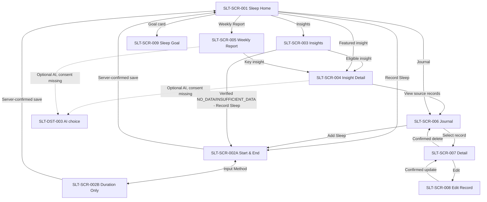

# Sleep Tracking — Behavior contract

> **Status:** BASELINE / DESIGNED. `CONFIRMED` = supported by canonical business rules or explicitly selected UX direction; `PROPOSED` = interaction detail for FE review; `OPEN` = requires a further decision. F1/F2 are **online-only**.
>
> Canonical source: [Sleep spec](https://github.com/vitaloom/vitaloom-business-docs-and-tools/blob/main/docs/usecase_spec/sleep-tracking/00-module.md) · [F1 rules](https://github.com/vitaloom/vitaloom-business-docs-and-tools/blob/main/docs/usecase_spec/sleep-tracking/f1-sleep-journal/rules.md) · [F2 rules](https://github.com/vitaloom/vitaloom-business-docs-and-tools/blob/main/docs/usecase_spec/sleep-tracking/f2-sleep-goals-insights/rules.md) · [SLT-UC-004](https://github.com/vitaloom/vitaloom-business-docs-and-tools/blob/main/docs/usecase_spec/sleep-tracking/f1-sleep-journal/SLT-UC-004_ghi-nhan-phien-ngu.md) · [SLT-UC-009](https://github.com/vitaloom/vitaloom-business-docs-and-tools/blob/main/docs/usecase_spec/sleep-tracking/f2-sleep-goals-insights/SLT-UC-009_kham-pha-sleep-insights.md). This file does **not** define backend endpoints.

## 1. Screen / destination registry

| ID | Page | Entry / exit | Authority |
| --- | --- | --- | --- |
| `SLT-SCR-001` | Sleep Home | AppShell Sleep metric entry; navigates to other Sleep/Report pages | F1/F2, BR-F2.31 |
| `SLT-SCR-002A` | Record Sleep — Start & End | `Record Sleep`, method A selected | SLT-UC-004 |
| `SLT-SCR-002B` | Record Sleep — Duration Only | Method switch inside same form; **one shared draft** | SLT-UC-004 |
| `SLT-SCR-003` | Sleep Insights | Home `Insights`; filter A/B/C | SLT-UC-009 |
| `SLT-SCR-004` | Insight Detail | Select an eligible insight; evidence/source | SLT-UC-009 |
| `SLT-SCR-005` | Weekly Sleep Report | Home `Weekly Report`, within HIR workflow | HIR-UC-002 + F2 |
| `SLT-SCR-006` | Sleep Journal | Home Journal, select record or Add Sleep | SLT-UC-005; [structure-only 7](7_sleep_journal.png) |
| `SLT-SCR-007` | Record Detail | Journal or linked source record; edit/delete | SLT-UC-005/006/007; [structure-only 8](8_sleep_record_detail.png) |
| `SLT-SCR-008` | Edit Record | Detail Edit, current version | SLT-UC-006; [structure-only 9](9_sleep_record_detail_edit.png) |
| `SLT-SCR-009` | Sleep Goal | Home Goal; set/update/remove | SLT-UC-008; [structure-only 10](10_sleep_goal_setup.png) |
| `SLT-SCR-003/NO_DATA` | Insights empty state | Verified no-data query | [structure-only 11](11_sleep_insight_empty.png), not a route |
| `SLT-SCR-003/INSUFFICIENT_DATA` | Insights insufficient state | Category-specific unmet eligibility | [structure-only 12](12_sleep_not_enough_data_insight.png), not a route |
| `SLT-DST-003` | AI data-use choice | On-demand when AI not yet opted in | BR-M.6/BR-F2.36, **screen placement OPEN** |

IDs refer to screens/destinations, **not hard-coded React Navigation route names**.

## 2. Navigation graph

**MANDATORY VISUAL CORRECTION:** New screenshot references 7–12 are structure-only and display an INCORRECT purple-dominant UI. Implement them green/mint wellness-first; purple only minor bed/pillow/icon accent. See [additional-screens specification](ADDITIONAL_SCREENS_20261111.md).

Shared Health Metrics Drawer / bottom navigation are owned by AppShell. Do not create a second drawer inside Sleep. Android Back/gesture should follow stack navigation; draft-discard confirmation is `PROPOSED`.

## 3. Interaction contract

| Action ID | Screen / component | Trigger and immediate feedback | Result / alternate outcome | Status / source |
| --- | --- | --- | --- | --- |
| `SLT-ACT-001` | Home / Record Sleep | Tap CTA | Open 002A; no data written yet | CONFIRMED design |
| `SLT-ACT-002` | Entry / Main Sleep, Nap | Switch type; selected pill visible | Update only draft classification | CONFIRMED BR-F1.1 |
| `SLT-ACT-003` | Entry / method tabs | Select Start & End or Duration Only | Swap relevant input controls; do **not** infer date-time from duration | CONFIRMED BR-F1.1–3; preserve draft values PROPOSED |
| `SLT-ACT-004` | 002A / Start Date picker | Open calendar, select date | Update Start date subject to no-future rule | CONFIRMED BR-F1.7, picker PROPOSED |
| `SLT-ACT-005` | 002A / Start Hour + Minute wheels | Scroll hour 00–23 and minute 00/15/30/45 | Update draft; normalize wrap/carry; do not save | CONFIRMED selected UI; carry PROPOSED |
| `SLT-ACT-006` | 002A / End Date + wheels | Select End date + hour/minute | Recalculate elapsed time from valid timezone-resolved instants; show validation if not resolvable | CONFIRMED BR-F1.2/4/8/9 |
| `SLT-ACT-007` | 002A / timezone reference | View/change reference zone for new time-range record | Both instants resolve in one zone; DST ambiguous/nonexistent times require explicit correction | CONFIRMED BR-F1.8/9; picker placement OPEN |
| `SLT-ACT-008` | 002B / End Date | Choose local end date (default suggestion today) | No artificial start/end timestamps | CONFIRMED BR-F1.3/7 |
| `SLT-ACT-009` | 002B / duration wheels | Choose hours and minute increment | Show duration; validate total minutes 1–1440 | CONFIRMED BR-F1.4; 0–100h wheel is visual-only |
| `SLT-ACT-010` | Entry / Comfortable, Normal, Tired | Tap one feeling; second tap may clear | Optional **single feeling per session**; blank remains allowed | CONFIRMED BR-F1.17; clear by retap PROPOSED |
| `SLT-ACT-011` | Entry / Save Sleep Record | Submit validated draft; pending spinner + disable duplicate taps | Success only after server confirmation → refresh Home; reject → retain draft; unknown response → reconcile before retry | CONFIRMED BR-F1.12/14/15 |
| `SLT-ACT-012` | Entry / Back | Back/gesture | Proposed dirty-draft confirmation: Discard / Keep editing; no save | PROPOSED |
| `SLT-ACT-013` | Home / Latest Sleep | Tap summary | View relevant Journal record | PROPOSED target, SLT-UC-005 |
| `SLT-ACT-014` | Home / Sleep Goal | Tap card | Open Goal management; show verified progress only if goal and data valid | CONFIRMED BR-F2.5/6/18, route PROPOSED |
| `SLT-ACT-015` | Home / Journal | Tap tile | Open Journal; absent record is not zero duration | CONFIRMED SLT-UC-005 |
| `SLT-ACT-016` | Home / Insights | Tap tile | Open 003; select All/Patterns/Feelings/Discoveries filter without fabricating missing insights | CONFIRMED SLT-UC-009 |
| `SLT-ACT-017` | Home / Featured insight | Tap the **one** valid featured insight | Open 004 using same insight ID/period/evidenceVersion | CONFIRMED BR-F2.31 |
| `SLT-ACT-018` | Insights / filter chips | Change A/B/C filter | Refilter READY insight entries; empty category state if none qualifies | CONFIRMED SLT-UC-009 |
| `SLT-ACT-019` | Insights / insight card | Tap eligible insight | Open 004; recheck data status/version | CONFIRMED BR-F2.30–32 |
| `SLT-ACT-020` | Insight Detail / AI Explanation | Request when opted in | Show validated interpretation after evidence; otherwise facts/template, no chatbot | CONFIRMED BR-F2.34–37 |
| `SLT-ACT-021` | Detail / Source Records | Tap action | Open permission-checked source journal records; 404/deleted → reload insight | CONFIRMED BR-F2.30/34, route PROPOSED |
| `SLT-ACT-022` | Home / Weekly Report | Tap tile | Open 005 within HIR-UC-002 | CONFIRMED owner; route PROPOSED |
| `SLT-ACT-023` | Report / week navigation | Previous / next week | Load server-verified aggregates; current week has no AI Story | CONFIRMED AI eligibility; control PROPOSED |
| `SLT-ACT-024` | Report / Key Insight | Tap card | Open 004 only if READY & evidence matches selected period | CONFIRMED BR-F2.30–33 |
| `SLT-ACT-025` | Report/Detail / AI data-use choice | Opt in or decline | Decline: factual metrics and deterministic explanations still available | CONFIRMED BR-M.6 / BR-F2.36 |

### New interaction mapping (2026-11-11)

| Action ID | Surface | Trigger | Result / exception |
|---|---|---|---|
| `SLT-ACT-026` | Journal | Open/view date group | Verified sessions grouped by stored statistical day; loading/unverified ≠ empty |
| `SLT-ACT-027` | Journal item | Tap card | Open 007 by confirmed session ID; duration-only has no invented clock times |
| `SLT-ACT-028` | Journal Add Sleep | Tap CTA | Open shared record entry form |
| `SLT-ACT-029` | Detail Edit | Tap | Load current record/revision; open 008; 404/stale → refresh |
| `SLT-ACT-030` | Edit Save | Submit | Validate and prevent duplicates; confirmed update → refresh detail; conflict/unknown → retain draft, reconcile |
| `SLT-ACT-031` | Detail Delete | Tap | Display confirmation before sending any write |
| `SLT-ACT-032` | Delete Confirm | Confirm | Confirmed delete → Journal; stale/unknown → reload/reconfirm, no false success |
| `SLT-ACT-033` | Goal hours/minutes | Change value | Validate 60–1440 minutes, 15-minute steps, 24h only 00m |
| `SLT-ACT-034` | Goal Save | Submit | Confirmed update then refresh; rejected/unknown keeps prior confirmed goal |
| `SLT-ACT-035` | Goal Remove | Tap, confirm | Confirmed removal only; historic goals retained |
| `SLT-ACT-036` | Insights NO_DATA | Record Sleep CTA | Navigate to new record form after verified no-data read |
| `SLT-ACT-037` | Insights INSUFFICIENT_DATA | Continue Tracking | Navigate record form; show insight-specific unmet criteria |
| `SLT-ACT-038` | Insights tabs | Change filter | Recompute READY / NO_DATA / INSUFFICIENT_DATA / UNVERIFIED per selected category |

**Important business corrections:** the detail screenshot's sample statistical day may conflict with the cross-midnight wake date; the *end date in stored reference timezone* is authoritative for a timed session. The duration-only Journal screenshot shows an end clock that is not available in a duration-only record and must not be synthesized. The Edit timezone for a persisted timed record is immutable. A three-day threshold in an insufficient-data screenshot is illustrative, not a universal rule. These new screenshots do **not** authorize purple UI colors.

## 4. Entry validation & time-picker contract

**Business constraints dominate visuals**: BR-F1.4 allows **1–1440 minutes** inclusive for one session. One day may contain several sessions and daily sum may exceed 24h; that does **not** relax the per-session limit.

| Input | Selected UI format | Behavior / validation |
| --- | --- | --- |
| Start (002A) | Date picker + hour wheel 00–23 + minute wheel | Date/time in same reference timezone as End; no future or unresolved DST |
| End (002A) | Date picker + hour wheel 00–23 + minute wheel | Must be later instant than Start; duration ≤1440 min, no overlaps |
| Minute wheel | 00 / 15 / 30 / 45 | **Minute 60 is not a persisted value.** Crossing 45 → 00 carries hour (and date at midnight); proposed UX |
| Duration (002B) | Hours wheel (visual proposal 0–100), Minutes wheel (00/15/30/45) | Total minutes = hours × 60 + minutes; allow only 1–1440. Above 24h invalid; 24:00 max |
| End Date (002B) | Date picker | User-selected statistical end day, suggested today; cannot be future |
| Feeling | Comfortable / Normal / Tired / none | Optional, session-scoped only |

**Known UX/spec tension:** Existing business rules allow arbitrary whole-minute durations 1–1440, while the selected wheels restrict selection to 15-minute steps. This is not a new business rule. FE should preserve exact values for existing/edited records and not round user data silently. Add an exact-minute fallback if required after review; marked `OPEN`.

For 002A, the illustration `Nov 10 23:15 → Nov 11 06:45 = 7h30` holds when the reference timezone has no offset transition between those instants. In a DST zone, resolve actual instants and recalculate; never subtract local clock labels blindly.

**No automatic coercion** on invalid entries, no fake 8h goal activated without a user action, and no implied quality/REM/sleep score.

## 5. Save, uncertainty and recovery

- `DRAFT`: selected fields are local only; no confirmed journal record.
- `VALIDATION_ERROR`: point to the relevant input (future time/day, invalid range/DST, duration 0/>1440, overlapping interval, invalid feeling). Retain valid fields.
- `SAVING`: disable duplicate submission, announce progress.
- `CONFIRMED`: only then return Home and refresh latest sleep, daily goal, Journal, eligible insights/report.
- `REJECTED`: show server-specific rejection without appending a record.
- `OUTCOME_UNKNOWN`: if response lost after send, do not assert success or failure; reconcile request/version before retry.
- `AUTH_REQUIRED` / `NETWORK_ERROR`: F1/F2 online-only; do not queue offline journal mutations.
- Concurrent edit/delete of source record: reload newest data and ask user to reconsider; no silent stale overwrite.

## 6. Home, insight and report rules

1. **Home:** latest confirmed session + optional feeling; goal progress only if goal history and verified data; at most **one** featured READY insight (BR-F2.31).
2. **Insights:** A=Patterns, B=Feelings, C=Discoveries. `C02` is deferred; C01 only if B02 eligible; categories can be empty. No fake discoveries to fill design.
3. **Detail:** use exact `insightCode, period, sample, sourceSessionIds, evidenceVersion, status`. Present deterministic evidence first, then limitations and optional AI explanation (AI text must be clearly separated from facts). Do not claim causality or medical diagnoses.
4. **Report:** Monday–Sunday selected by HIR. Missing day `—` means **not recorded**, not zero sleep. Only completed/verified weeks with eligible advanced insights and AI opt-in may show **AI Weekly Sleep Story** (≤2 observations); otherwise show normal metrics and deterministic copy **without AI label**.
5. **Stale:** server-confirmed changes to source sessions/feeling/goal version invalidate relevant insights and AI text. Hide stale claims and reload; preserve factual fallback if valid.
6. **Privacy:** never send whole raw journal by default for AI; present data-use disclosure & opt-in. Without consent, show numeric analytics and non-AI explanation.

## 7. Accessibility

Use native touch targets ≥44×44 pt, real buttons for reactions/filters, programmatic selected states and labels, scrollable layouts, focus on form errors, readable contrast and reduce-motion awareness. Announce save states. Wheel picker supports accessibility increment/decrement and visible values. Decorative artwork is excluded from screen-reader focus. AppShell controls are reused, not redrawn in feature-owned code.

## 8. Acceptance checklist

- [ ] A/B share one screen component/form draft but do not invent missing timestamps.
- [ ] Start/End each expose date + hour + minute controls; both share timezone reference and DST validation.
- [ ] Duration has end-date + hour/minute, accepts 1–1440 minutes and preserves exact historic values.
- [ ] Feeling is optional and saved per session only.
- [ ] No duplicate requests or false success on response loss, stale edit, or overlapping intervals.
- [ ] No goal indicator without valid goal history, no sleep score/stages, no empty day represented as 0h.
- [ ] Home has ≤1 featured eligible insight; filtering never invents C insights.
- [ ] Detail evidence, AI output and source records reference same verified version.
- [ ] AI failure/opt-out leaves reports, Journal and deterministic insights usable.
- [ ] Weekly AI story excludes current/unverified weeks and unsupported causal claims.
- [ ] Shared shell/drawer stays shared; no feature-specific copy.
- [ ] Image links used as implementation references exist before calling binary import complete.

## 9. Open UX / cross-module items

- `SLT-UX-OPEN-001`: exact-minute input for non-15-minute values (preserve/modify previously accepted records).
- `SLT-UX-OPEN-002`: reference timezone picker placement, DST ambiguity resolution UI, and travel cases.
- `SLT-UX-OPEN-003`: new/edit dirty draft policy and switching methods with partially completed values.
- `SLT-UX-OPEN-004`: location/wording of AI consent/disclosure and revoke flow; privacy review.
- `SLT-UX-OPEN-005`: synchronize HIR-UC-002 report ownership/AI presentation rules; no duplicate Sleep workflow.
- `SLT-UX-OPEN-006`: Journal/Detail/Edit/Goal and Insights NO_DATA/INSUFFICIENT_DATA structural references now exist; corrected GREEN FE visuals and remaining error/confirmation states are pending approval.
- `SLT-UX-OPEN-007`: new independent assets bed.png and star-pillow-cloud.png uploaded; verify their use in green-themed FE. SVGs remain merely proposed alternatives.

## Change log

- 2026-11-11 — Registered images 7–12, Journal/Detail/Edit/Goal and Insights NO_DATA/INSUFFICIENT states, actions 026–038, and mandatory green wellness palette override (purple screenshot colors rejected).

- 2026-11-11 — Defined selected 6-screen baseline interaction contract, wheel picker normalization proposal, A/B/C evidence constraints, and offline/AI failure behavior.
