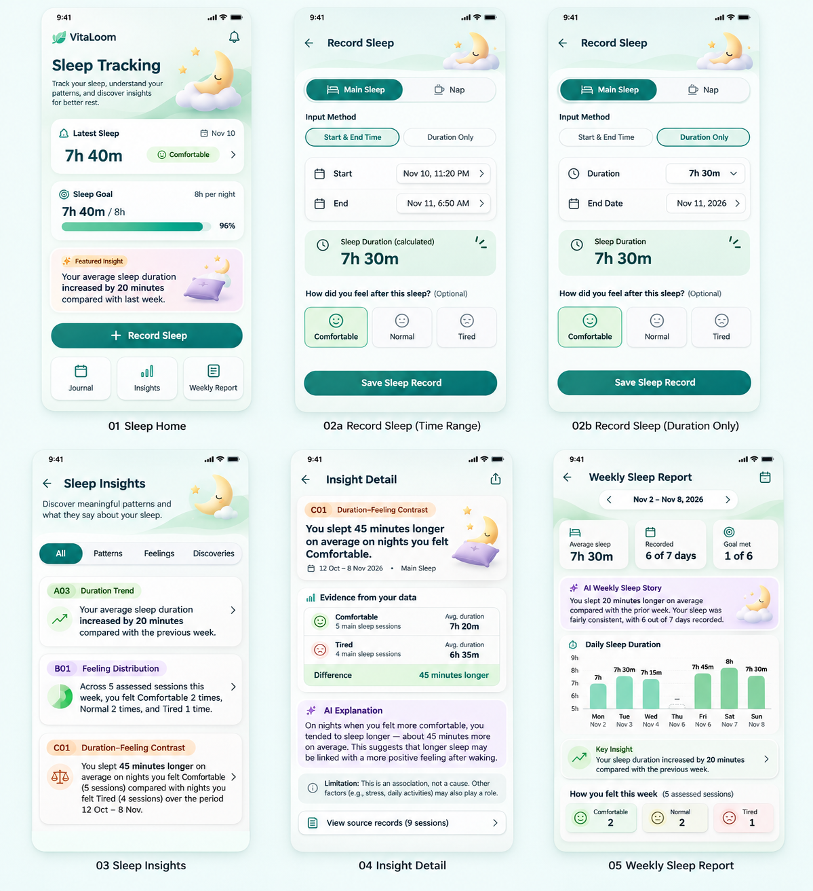

# VitaLoom — Sleep Tracking (UI baseline)

> **Design status:** selected visual direction / approved concept by product owner (2026-11-11). This repository change publishes **behavior and asset integration guidance**. The original six selected screenshots and nine original standalone assets are committed. Six additional images and two new artwork assets were committed in `fba900f`/`7dd2fa9`. **MANDATORY: NEW SCREENSHOTS 7–12 ARE STRUCTURE-ONLY; THEIR PURPLE-DOMINANT COLORS ARE INCORRECT AND MUST BE REPLACED WITH THE EXISTING GREEN WELLNESS UI.** Purple remains only a minor decorative illustration/icon accent. See [2026-11-11 additional screens and correction](ADDITIONAL_SCREENS_20261111.md).
>
> **Implementation:** not evidence of a running React Native screen or implemented API.

## Source of truth

- [Sleep module scope](https://github.com/vitaloom/vitaloom-business-docs-and-tools/blob/main/docs/usecase_spec/sleep-tracking/00-module.md), [F1 Journal rules](https://github.com/vitaloom/vitaloom-business-docs-and-tools/blob/main/docs/usecase_spec/sleep-tracking/f1-sleep-journal/rules.md), [F2 Goal/Insights rules](https://github.com/vitaloom/vitaloom-business-docs-and-tools/blob/main/docs/usecase_spec/sleep-tracking/f2-sleep-goals-insights/rules.md)
- [F2 insight catalog A/B/C](https://github.com/vitaloom/vitaloom-business-docs-and-tools/blob/main/docs/usecase_spec/sleep-tracking/f2-sleep-goals-insights/insight-catalog-v2.md), [AI-content guardrails](https://github.com/vitaloom/vitaloom-business-docs-and-tools/blob/main/docs/usecase_spec/sleep-tracking/f2-sleep-goals-insights/ai-content-guidelines.md)
- [Global behavior standard](../BEHAVIOR_STANDARD.md), [Global asset mapping standard](../ASSET_MAPPING_STANDARD.md)
- [Shared app navigation drawer](../shared/health-metrics-sidebar/README.md)

## Baseline screen registry

| Stable ID | Selected screen / PNG filename | Owner and scope | File |
| --- | --- | --- | --- |
| SLT-SCR-001 | [`01-sleep-home.png`](./01-sleep-home.png) | Journal + Goal + one featured insight | AVAILABLE / PNG |
| SLT-SCR-002A | [`02a-sleep-entry-time-range.png`](./02a-sleep-entry-time-range.png) | SLT-UC-004: start/end with date + hour/minute selectors | AVAILABLE / PNG |
| SLT-SCR-002B | [`02b-sleep-entry-duration-only.png`](./02b-sleep-entry-duration-only.png) | SLT-UC-004: duration + end date | AVAILABLE / PNG |
| SLT-SCR-003 | [`03-sleep-insights.png`](./03-sleep-insights.png) | SLT-UC-009: A/B/C discovery | AVAILABLE / PNG |
| SLT-SCR-004 | [`04-ai-insight-detail.png`](./04-ai-insight-detail.png) | SLT-UC-009: evidence + optional AI explanation | AVAILABLE / PNG |
| SLT-SCR-005 | [`05-ai-weekly-sleep-story.png`](./05-ai-weekly-sleep-story.png) | HIR-UC-002: weekly report section, Sleep F2 metrics | AVAILABLE / PNG |

### Supplemental screen references — NOT palette baselines

| Stable ID/state | Image | Scope | Status |
|---|---|---|---|
| `SLT-SCR-006` | [Journal](7_sleep_journal.png) | SLT-UC-005 | STRUCTURE_ONLY_COLOR_OVERRIDE_REQUIRED |
| `SLT-SCR-007` | [Record Detail](8_sleep_record_detail.png) | SLT-UC-005/006/007 | STRUCTURE_ONLY_COLOR_OVERRIDE_REQUIRED |
| `SLT-SCR-008` | [Edit Record](9_sleep_record_detail_edit.png) | SLT-UC-006 | STRUCTURE_ONLY_COLOR_OVERRIDE_REQUIRED |
| `SLT-SCR-009` | [Sleep Goal](10_sleep_goal_setup.png) | SLT-UC-008 | STRUCTURE_ONLY_COLOR_OVERRIDE_REQUIRED |
| `SLT-SCR-003/NO_DATA` | [Insights Empty](11_sleep_insight_empty.png) | SLT-UC-009 | STRUCTURE_ONLY_COLOR_OVERRIDE_REQUIRED; UI state, no new route |
| `SLT-SCR-003/INSUFFICIENT_DATA` | [Not Enough Data](12_sleep_not_enough_data_insight.png) | SLT-UC-009 | STRUCTURE_ONLY_COLOR_OVERRIDE_REQUIRED; UI state, no new route |

**Green/mint wellness is the REQUIRED dominant color** for all six implementations; preserve only the layout and content of their purple images. The two independent artwork PNGs [star-pillow-cloud](../assets/sleep-tracking/star-pillow-cloud.png) and [bed](../assets/sleep-tracking/bed.png) may supply decorative accents. FE visual acceptance pending.

Also available: [`00-sleep-design-overview.png`](./00-sleep-design-overview.png) (selected multi-screen overview; not an interactive screen).

### Important visual decisions

- **REQUIRED**: VitaLoom Soft Wellness **green/mint dominant UI**, cream/neutral surfaces, green/teal CTAs, purple only minor asset/icon emphasis (~10% maximum visual impression). **Never copy purple dominant backgrounds, headings, cards, buttons or progress from images 7–12.**
- **Same form shell and action order** for 002A/002B; only method-specific inputs differ.
- **Time-range input:** separate **Date**, **Hour (00–23)**, **Minute wheel** controls for both Start and End. The minute wheel represents `00/15/30/45`; wheel transition past 45 wraps to 00 and carries to hour/date, rather than storing minute 60.
- **Duration-only input:** End Date plus duration **Hours wheel / Minutes wheel**; proposed wheel range 0–100h is a visual affordance, **NOT** a valid storage range. Business validity is 1–1440 minutes per session. Values above 24h, or 24h with nonzero minute, must be invalid/disabled.
- The reference screenshots contain **example data**, not API responses and not clinical evaluations.

## Handoff artifacts

- [BEHAVIOR.md](BEHAVIOR.md) — navigation, actions, validation, failure handling, eligibility, acceptance checks.
- [SCREEN_STATES.md](SCREEN_STATES.md) — state matrix for loading/empty/errors/AI.
- [ASSET_MAPPING.md](ASSET_MAPPING.md) — per-screen composition & actual proposed SVG fallback inventory.
- [FE_HANDOFF.md](FE_HANDOFF.md) — UI data dependencies, API-contract boundaries, Expo implementation notes.
- [SCREEN_IMPORT.md](SCREEN_IMPORT.md) — original PNG verification + supplemental upload record.
- [ADDITIONAL_SCREENS_20261111.md](ADDITIONAL_SCREENS_20261111.md) — **mandatory color correction, new screen flows and asset mapping**.
- [Screen manifest](screen-manifest.json), [small asset catalog](../assets/sleep-tracking/README.md).

## Ownership / deferred screens

- **Sleep Journal / record detail/edit/delete**: SLT-UC-005/006/007 — structural images 7–9 now available; correct to green wellness before FE approval.
- **Sleep Goal Management**: SLT-UC-008 — structural image 10 now available; correct to green wellness. Suggested 8h goal is never auto-saved.
- **Insights empty/insufficient**: images 11/12 now cover two states of existing screen 003, not new screens; eligibility copy is rule-dependent.
- **Weekly Report** belongs to **HIR-UC-002**, not a newly invented Sleep UC. Sleep supplies metrics, insight/evidence and data-state eligibility.
- **Post-MVP** reminders, wearables, sleep stages, sleep coaching, free-form chat and offline journal queue are excluded.

Approval of the selected screenshot appearance does not by itself approve every illustrative numeric value, a new API contract, an SVG fallback, or an unreviewed navigation/detail screen.
