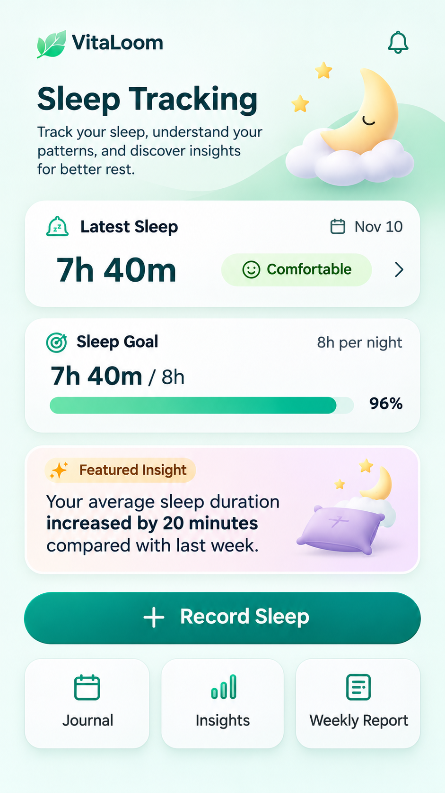

# VitaLoom — Sleep Tracking design baseline

**Source:** Six full-screen PNGs and nine independent PNG assets manually uploaded to `main` (2026-11-11). **Status:** `BASELINE_UPLOADED` — screen files exist as design references; independent asset-to-screen placements below are `PROPOSED / VISUAL_QA_REQUIRED` until verified against the full-screen PNGs. This documentation does not imply frontend implementation, API readiness or formal sign-off.

**Design contracts:** [Behavior](BEHAVIOR.md) · [Screen-to-asset mapping](ASSET_MAPPING.md) · [Screen manifest](screen-manifest.json) · [Asset catalog](../assets/sleep-tracking/README.md) · [Global behavior standard](../BEHAVIOR_STANDARD.md) · [Global mapping standard](../ASSET_MAPPING_STANDARD.md).

## Uploaded screen catalog

| Stable ID | Full-screen baseline (unchanged filename) | Scenario | Domain workflow |
| --- | --- | --- | --- |
| `SLT-SCR-001` | [1_sleep_tracking_main_screen.png](./1_sleep_tracking_main_screen.png) | Sleep Home | `SLT-UC-005 / SLT-UC-008 / SLT-UC-009 (entry)` |
| `SLT-SCR-002` | [2_record_start_end_time_sleep.png](./2_record_start_end_time_sleep.png) | Record Sleep — start/end | `SLT-UC-004` |
| `SLT-SCR-003` | [3_record_duration_sleep.png](./3_record_duration_sleep.png) | Record Sleep — duration only | `SLT-UC-004` |
| `SLT-SCR-004` | [4_sleep_insights_screen.png](./4_sleep_insights_screen.png) | Sleep Insights | `SLT-UC-009` |
| `SLT-SCR-005` | [5_insight-detail-screeen.png](./5_insight-detail-screeen.png) | Insight Detail | `SLT-UC-009` |
| `SLT-SCR-006` | [6_weekly_report_screen.png](./6_weekly_report_screen.png) | Weekly Sleep Report visual | `HIR-UC-002` |

> `SLT-SCR-006` is kept as a Sleep-oriented **visual baseline**, but selecting week / metric and rendering a Weekly Metric Report is owned by **HIR-UC-002**, not a new Sleep use case. Sleep F2 owns aggregates, insight evidence, data eligibility and AI story policy.

## Actual coverage and gaps

- **Available images:** Sleep Home; two **alternatives of one** sleep-entry flow (start/end or duration-only); Insights; Insight Detail; Weekly Report reference.
- **Not uploaded as separate full-screen designs:** sleep-journal list and entry detail/edit/delete confirmation; sleep-goal setup/edit/remove; explicit empty/loading/validation/conflict/unconfirmed-result states; AI consent notice. These remain behavior/state requirements or proposed overlay destinations, **not imaginary screenshots**.
- The mockups can contain illustrative values, charts, labels and navigation controls. Build real text, charts, selectors, time/date pickers, dialogs and stateful controls as native React Native/Expo components; do not embed the entire PNG as a functional screen.
- Sleep main-screen daily progress must come from confirmed F1 sessions and effective Sleep Goal. The suggestion **8h/day** is not active until explicitly saved (BR-F2.5–6); no data means **not recorded**, not zero sleep.
- Sleep F1/F2 are **online-only**. Bedtime reminders, notifications, offline sync, sensor tracking, sleep-stage charts, medical claims, free-form AI chat and AI coaching are outside this scope.

## Canonical specification and responsibilities

- [Sleep module scope](https://github.com/vitaloom/vitaloom-business-docs-and-tools/blob/main/docs/usecase_spec/sleep-tracking/00-module.md).
- [F1 Journal rules](https://github.com/vitaloom/vitaloom-business-docs-and-tools/blob/main/docs/usecase_spec/sleep-tracking/f1-sleep-journal/rules.md) and [SLT-UC-004–007](https://github.com/vitaloom/vitaloom-business-docs-and-tools/blob/main/docs/usecase_spec/sleep-tracking/f1-sleep-journal/README.md) — manually reported sessions, methods, feeling, history, edit and delete.
- [F2 Goal / Insights rules](https://github.com/vitaloom/vitaloom-business-docs-and-tools/blob/main/docs/usecase_spec/sleep-tracking/f2-sleep-goals-insights/rules.md), [Insight catalog A/B/C](https://github.com/vitaloom/vitaloom-business-docs-and-tools/blob/main/docs/usecase_spec/sleep-tracking/f2-sleep-goals-insights/insight-catalog-v2.md), [AI content rules](https://github.com/vitaloom/vitaloom-business-docs-and-tools/blob/main/docs/usecase_spec/sleep-tracking/f2-sleep-goals-insights/ai-content-guidelines.md) and [UX decisions](https://github.com/vitaloom/vitaloom-business-docs-and-tools/blob/main/docs/usecase_spec/sleep-tracking/f2-sleep-goals-insights/ux-decision-traceability.md).
- [HIR-UC-002 Weekly Metric Report](https://github.com/vitaloom/vitaloom-business-docs-and-tools/blob/main/docs/usecase_spec/health-insights-reports/f2-weekly-metric-reports/HIR-UC-002_xem-weekly-metric-report.md) — report workflow owner.

**Implementation handoff order:** read this catalog → [Behavior](BEHAVIOR.md) → [Asset mapping](ASSET_MAPPING.md) → business rules/UC → define FE routes/API contracts inside the frontend/backend repositories. Never derive backend endpoint names from screenshot text.

## Visual and behavior review

- [x] Link to every existing baseline PNG using its exact uploaded filename.
- [x] Distinguish screenshot baseline from independent reusable artwork.
- [x] List currently missing visual states without inventing references.
- [ ] Visually verify each proposed independent asset placement against the six original screenshots and then mark `APPROVED` where justified.
- [ ] Verify typography, safe areas, small-screen scrolling and native accessibility in Expo.
- [ ] Confirm any visual decisions that diverge from canonical F1/F2/HIR business rules.
