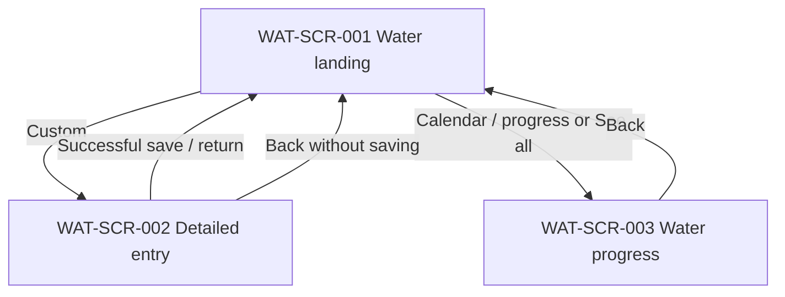

# Water — Screen Behavior

> **Status:** DRAFT (interaction mapping for design handoff; review against canonical UC/BR before declaring production-ready)  
> **Scope:** Three existing Water design images; no new domain business rules or backend endpoints.  
> **Canonical business requirements:** [Water Intake Tracking](https://github.com/vitaloom/vitaloom-business-docs-and-tools/tree/main/docs/usecase_spec/water-intake-tracking)  
> **Shared navigation:** [Health Metrics Sidebar](../shared/health-metrics-sidebar/README.md)  
> **Visual asset policy:** [`assets/water/`](../assets/water/README.md)

## 1. Screen registry

| Screen ID | Name | Visual design | Entry / responsibility |
| --- | --- | --- | --- |
| `WAT-SCR-001` | Water landing | [water-intake-tracking.png](water-intake-tracking.png) | Water section opens; present today's total, goal and recent entries |
| `WAT-SCR-002` | Detailed water entry | [chi tiết nhập nước.png](./chi%20ti%E1%BA%BFt%20nh%E1%BA%ADp%20n%C6%B0%E1%BB%9Bc.png) | Opened from the Custom quick-add action |
| `WAT-SCR-003` | Water progress | [tiến độ nước.png](./ti%E1%BA%BFn%20%C4%91%E1%BB%99%20n%C6%B0%E1%BB%9Bc.png) | Opened from progress/calendar or See all; selected day/week context |

Images represent design intent; exact timestamps and values in them are sample data.

## 2. Navigation flow

Water-to-Home navigation is owned by the shared app shell, not duplicated in Water designs. If the app separates a complete journal from progress, that destination requires its own screen/document; currently this is **OPEN**.

## 3. Interaction contract

| Action ID | Screen / control | User trigger and visible feedback | Expected outcome / next screen | Status |
| --- | --- | --- | --- | --- |
| `WAT-ACT-001` | Landing / quick amount | Tap one of the three preset quick-add amounts; show selected styling | Selection updates locally without saving yet | Design intent |
| `WAT-ACT-002` | Landing / Add log | Tap after choosing amount; show pending state, block duplicate submits | Save with the current time; show success and update daily total/recent logs; failure retains selection and offers retry | Design intent; API/error UX PROPOSED |
| `WAT-ACT-003` | Landing / Custom | Tap Custom | Navigate to `WAT-SCR-002`; do not save anything yet | Design intent |
| `WAT-ACT-004` | Landing / calendar-progress | Tap header calendar/progress | Navigate to `WAT-SCR-003` | Design intent |
| `WAT-ACT-005` | Landing / See all | Tap from latest five entries | Navigate to `WAT-SCR-003` under current screen set; separate journal destination is OPEN | Partial/OPEN |
| `WAT-ACT-006` | Detail / preset amount | Tap preset amount | Prefill amount; allow further manual edits | Design intent |
| `WAT-ACT-007` | Detail / amount input | Type/edit amount | Show typed value and applicable validation feedback | Design intent; validation per canonical BR |
| `WAT-ACT-008` | Detail / time | Choose recorded time | Show chosen local time; future time should be rejected per accepted UX intent, subject to canonical BR | Design intent |
| `WAT-ACT-009` | Detail / Save | Submit valid entry; show pending state | Success → `WAT-SCR-001` with updated data; error → remain on `WAT-SCR-002` and preserve values | Design intent; recovery UX PROPOSED |
| `WAT-ACT-010` | Progress / week/day selector | Tap a day or navigate weeks | Highlight selected date; load relevant progress and entries | Design intent |
| `WAT-ACT-011` | Progress / Back | Tap back | Return to `WAT-SCR-001` | PROPOSED |
| `WAT-ACT-012` | Shared menu/drawer | Tap shared menu | Use common drawer contract; Water screen itself does not own a second drawer | CONFIRMED by shared sidebar spec |

**Note:** The three preset landing amounts, four detail presets and default daily goal are design/product inputs, not newly defined here as domain rules. Verify the approved specs before coding quantity limits, goal-history semantics or timezone handling.

## 4. UI states and feedback

| Screen | UI state | Behavior / intended feedback |
| --- | --- | --- |
| Landing | Initial/loading | Keep static controls visible; show progress indicator/skeleton for API-derived totals and recent entries |
| Landing | No recent entries | Explain no logs recorded yet; never render fake entries |
| Landing | Quick option selected | Clear selected state with visual and accessible feedback; adding requires explicit confirmation |
| Landing | Save pending/success | Disable duplicate submit; refresh today's progress and latest entries after confirmed save |
| Detail | Initial/dirty | Show editable amount/time; retain input when validation fails |
| Detail | Invalid amount/time | Show field-specific error and prevent invalid submission |
| Progress | Day selection/loading | Preserve selected date; distinguish pending data from an empty date |
| Any | Network/server error | Display a retry option; do not present network failure as no data |

These are UX recommendations where not already approved by business specs; illustrations for every state are not yet available.

## 5. Business traceability and data

- Read and follow the latest approved Water UC/BR from [canonical source](https://github.com/vitaloom/vitaloom-business-docs-and-tools/tree/main/docs/usecase_spec/water-intake-tracking).
- Today/daily goal/history are user-scoped. Goal effectiveness by date, day boundaries and timezone behavior are **not defined by this file**.
- Backend endpoint names, request payloads and error codes must come from the backend API contract, not from these image filenames.
- When API data is missing, display an empty state. When data cannot be fetched, display an error state. Do not conflate these.
- Shared app navigation comes from [the shared sidebar spec](../shared/health-metrics-sidebar/README.md).

## 6. Accessibility and recoverability

- Buttons and date/amount choices need accessible labels and selected/disabled states that do not rely on color alone.
- Distinguish submit pending, success and failure; announce failures and keep valid user input available for retry.
- Use touch target sizes suitable for mobile and do not cover form fields with the keyboard.
- System Back should follow the app's navigation contract; unsaved detail input policy requires a confirmed decision if a discard prompt is needed.

## 7. Visual assets

The three files under [Water](README.md) are **complete screen designs**, not small PNG assets. Store any separately exported transparent bottle, drop icon or illustration component under [`assets/water/`](../assets/water/README.md) and refer to the **actual file** here after it exists.

## 8. Acceptance checklist

- [ ] `WAT-ACT-001/002`: choosing a preset alone does not save; explicit Add log does.
- [ ] `WAT-ACT-003/006/009`: Custom opens editable detail; Save returns only after confirmed success.
- [ ] `WAT-ACT-004/010`: selecting a day updates daily progress and entries for the intended day.
- [ ] API failures, validation errors, no-data and loading appear as distinct UI states.
- [ ] Shared drawer reused; no feature-specific duplicate shell/sidebar.
- [ ] Check current UC/BR before treating the sample imagery as domain policy.

## 9. Open design decisions

| ID | Question | Impact |
| --- | --- | --- |
| `WAT-UX-OPEN-001` | Does 'See all' require a separate full journal screen, or use Progress with the selected day? | Navigation route and potential new design |
| `WAT-UX-OPEN-002` | What is the policy when the user leaves a dirty detailed-entry form? | Back / discard confirmation UX |
| `WAT-UX-OPEN-003` | Which loading, empty, failed and success-state assets should be added? | UI coverage across three screens |

## Change log

- 2026-11-10 — Initial documentation mapping existing three visual designs to proposed and known interaction behavior. No images moved or renamed.
